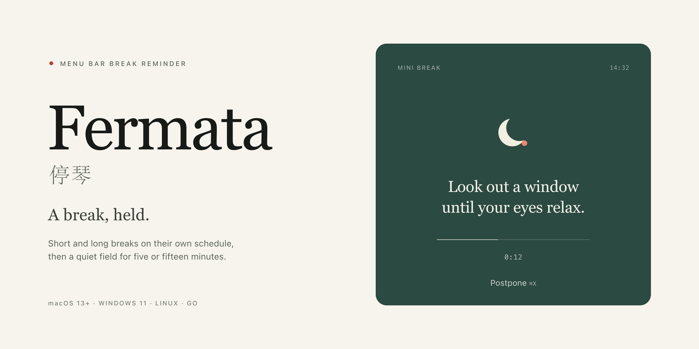
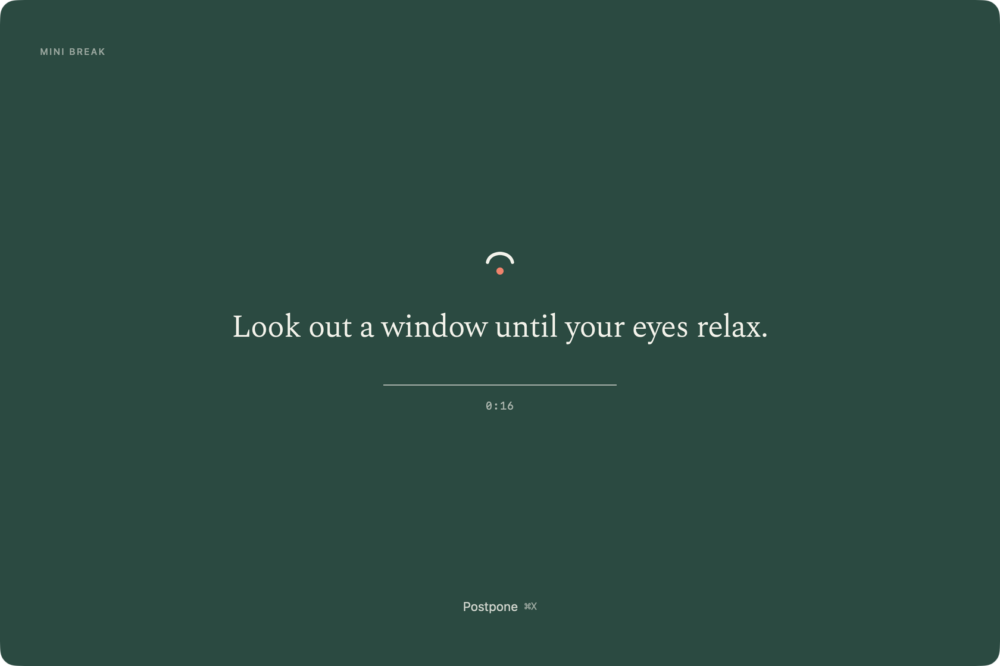
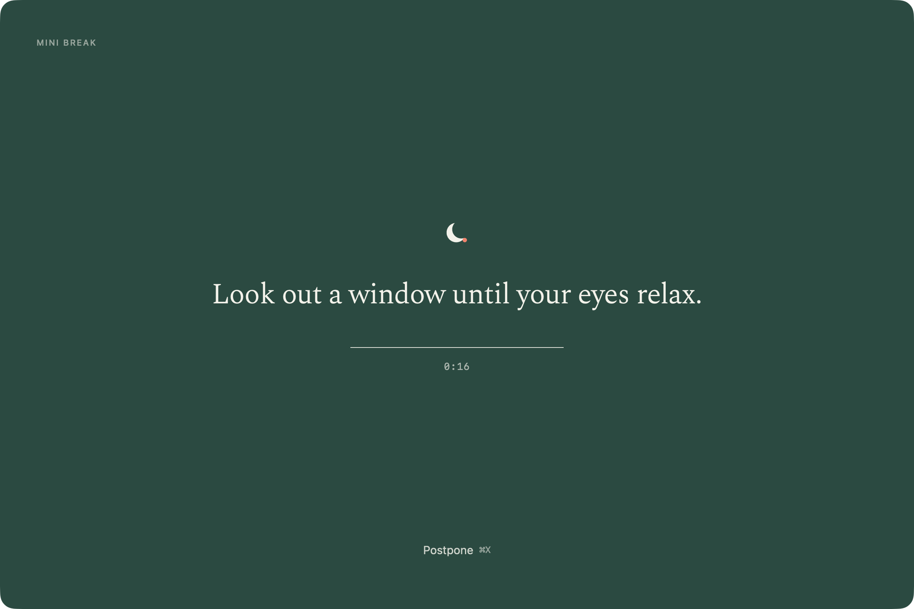
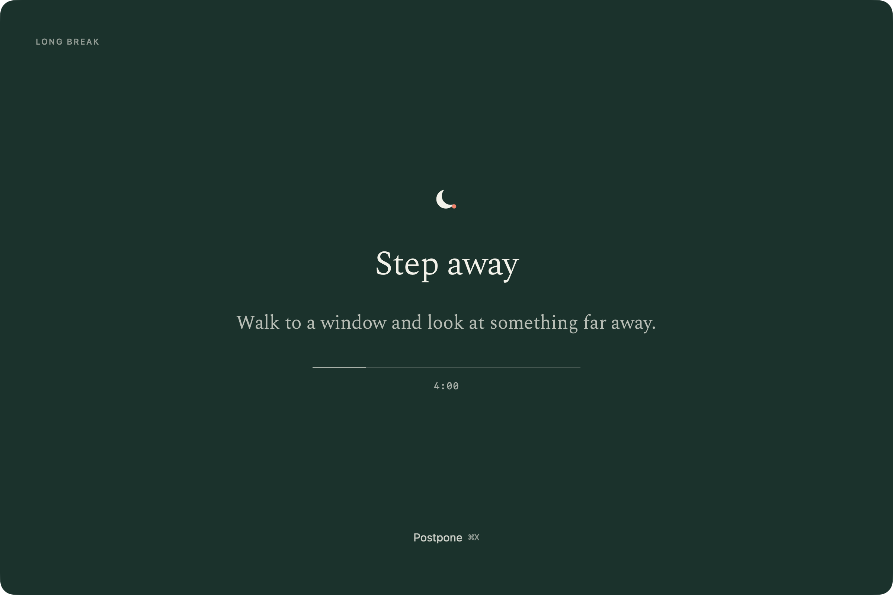
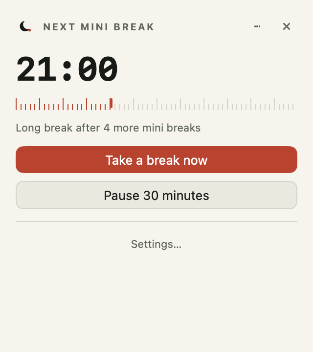
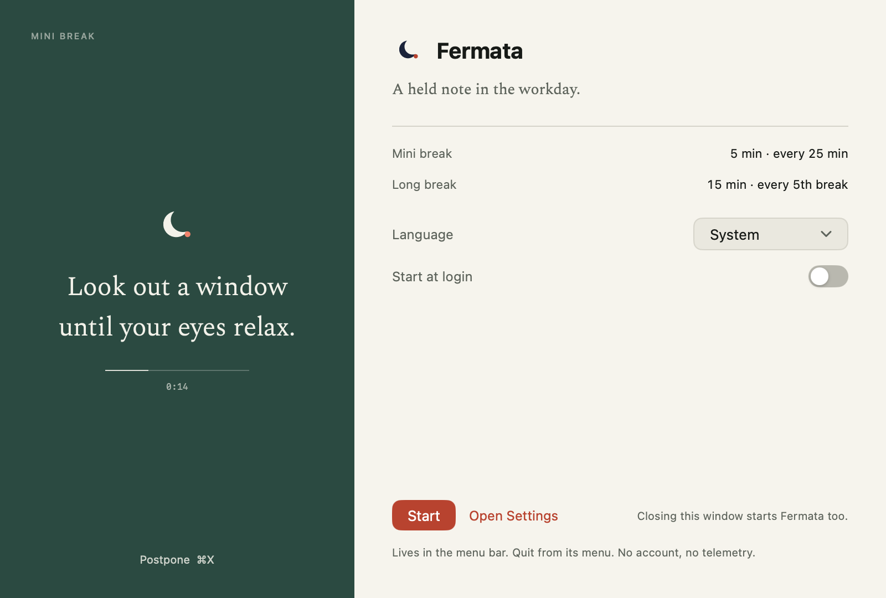
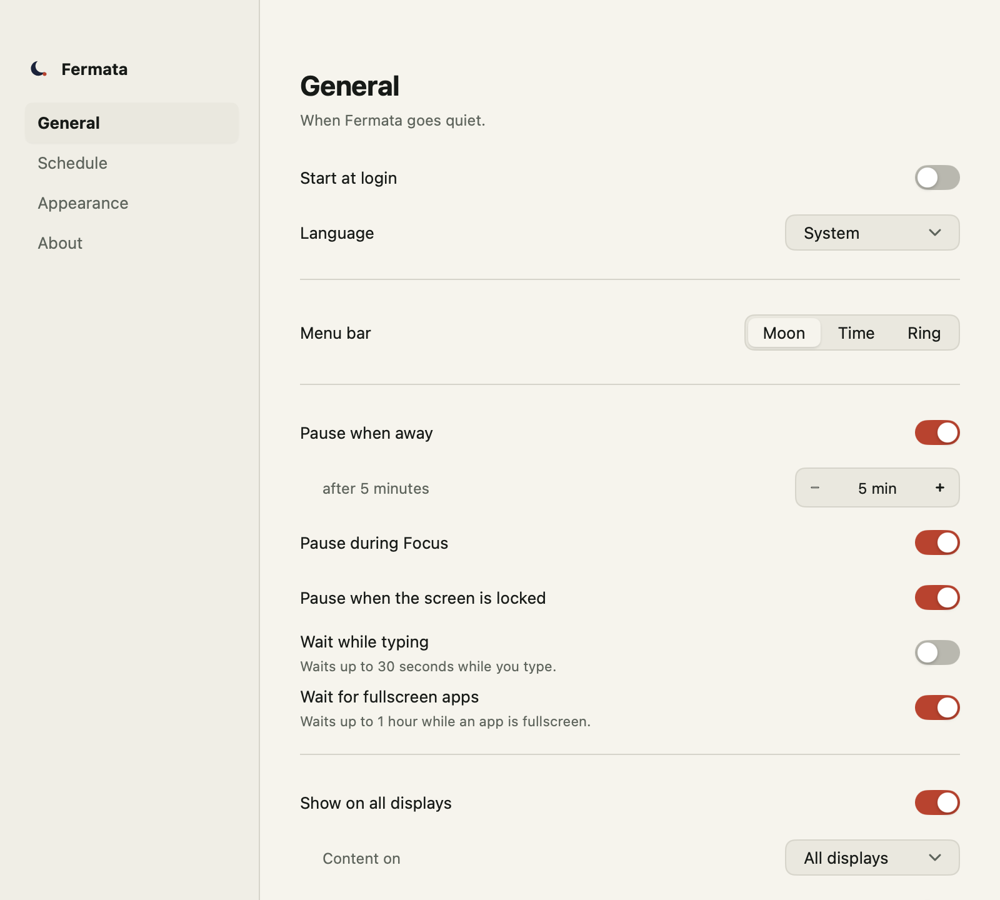
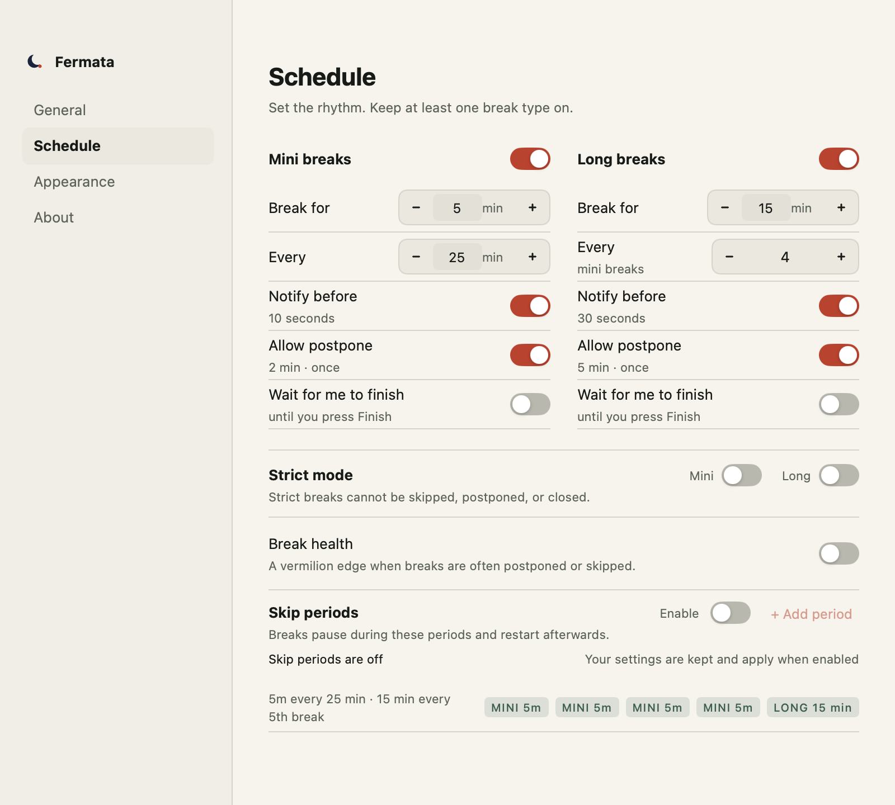
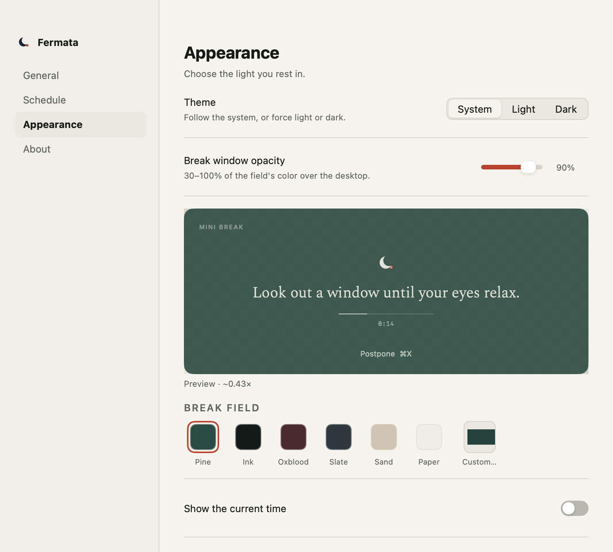
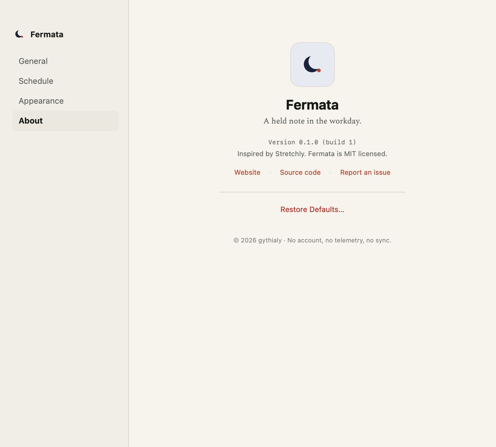

<p align="center">
  <a href="https://github.com/gythialy/fermata">
    
  </a>
</p>

# Fermata · 停琴

**A break reminder for macOS, Windows and Linux.** It lives in the menu bar or
the system tray; short and long breaks arrive on their own schedule, take the
screen for a few minutes, and then get out of the way.
Inspired by [Stretchly](https://github.com/hovancik/stretchly), written in Go
with [MyGo](https://github.com/egoist/mygo): one process, a native menu bar
item, no webview.

English · [简体中文](README.zh-Hans.md)

[](https://github.com/gythialy/fermata/blob/main/go.mod)
[](https://github.com/gythialy/fermata/actions/workflows/ci.yml)
[](https://github.com/gythialy/fermata/blob/main/LICENSE)
[](https://github.com/gythialy/fermata/blob/main/docs/development.md#requirements)
[](https://github.com/gythialy/fermata/actions/workflows/nightly.yml)

## What it does

- **A rhythm you can keep.** Pomodoro by default: a 5-minute mini break every
  25 minutes, and a 15-minute long break after every four mini breaks. Both
  kinds are adjustable, and at least one stays on.
- **A break field, not a dialog.** One window per display at 85% of the
  screen, holding the moon, one suggestion, a hairline that fills with the
  break, the countdown, and exactly one exit — `Postpone`, then `Skip`, then
  `Finish` for a break that waits for you. `⌘X` does the same from the keyboard.
- **Strict mode when you mean it.** No postponing, no skipping, no closing the
  window, and the app refuses to quit until the break ends. A locked screen or
  a sleeping Mac still ends it.
- **Pause without leaving the menu bar.** 30 minutes, 1 hour, 2 hours,
  5 hours, until morning, or indefinitely. It also pauses by itself when you
  are away, during Focus, while the screen is locked, and for apps you exclude.
- **A due break that waits for the moment.** While an app is fullscreen (up to
  an hour), or — when enabled — while you are typing (up to 30 seconds), the
  break holds and then starts with its full duration. Fullscreen detection reads
  window bounds only: no screen-recording permission.
- **Settings that stay quiet.** General, Schedule, Appearance and About;
  English, 简体中文 or the system's language; start at login; menu bar style
  (mark, time or ring); break field colours and opacity; sounds and volume;
  app exclusions; break health; restore defaults.
- **A status popover instead of a wall of menu items.** Left-click the icon
  (or a break notice) for the countdown and quick actions; right-click keeps
  the classic menu.
- **It remembers a waiting countdown.** If the app restarts within ten minutes
  of the next break, the countdown continues; a break in progress or a pause
  does not resume.
- **Quiet about updates.** It checks GitHub Releases in the background and
  tells you in About; nothing downloads or installs by itself.

## Screenshots

<p align="center">
  <a href="docs/images/break-mini.png"></a>
</p>

The break field, 85% of the screen: the moon, one suggestion, a hairline that
fills with the break, the countdown, and one exit at a time. The loop is drawn
by the app itself, frame by frame; click it for a still at full size.

| Short break | Long break |
|:-:|:-:|
| <a href="docs/images/break-mini.png"></a> | <a href="docs/images/break-long.png"></a> |
| Five minutes, every twenty-five. | Fifteen minutes, after four mini breaks. |

### Around the app

| Status popover | First run |
|:-:|:-:|
| <a href="docs/images/popover.png"></a> | <a href="docs/images/welcome.png"></a> |
| The countdown and the quick actions, from the menu bar. | A preview of the break, before the first one arrives. |

### Settings

| General | Schedule |
|:-:|:-:|
| <a href="docs/images/settings-general.png"></a> | <a href="docs/images/settings-schedule.png"></a> |
| Start at login, language, menu bar style, the pauses. | Break lengths, postpone and skip. |

| Appearance | About |
|:-:|:-:|
| <a href="docs/images/settings-appearance.png"></a> | <a href="docs/images/settings-about.png"></a> |
| Break field colour and opacity, sounds and volume. | Version, updates and the licence. |

## Install

### macOS

macOS 13 or later, via [Homebrew](https://brew.sh):

```sh
brew tap gythialy/tap
brew trust gythialy/tap
brew install --cask fermata
```

The cask lives in [gythialy/homebrew-tap](https://github.com/gythialy/homebrew-tap).
Fermata is ad-hoc signed and not notarized; the cask clears the download
quarantine, and if macOS still blocks the first launch, right-click the app and
choose **Open**. Update with `brew upgrade --cask fermata`.

### Windows

From the [releases page](https://github.com/gythialy/fermata/releases/latest),
for x64 or ARM64:

- `fermata-<version>-windows-<arch>-setup.exe` installs for the current
  user into `%LOCALAPPDATA%\Programs\Fermata`, with a Start menu shortcut and an
  uninstaller.
- `fermata-<version>-windows-<arch>-portable.zip` runs from any folder.

The Windows builds are not code signed yet, so SmartScreen warns on the first
run: choose **More info → Run anyway**. The tray has no title there, so the icon
shows the mark or the ring rather than a countdown.

### Linux

Packages for x86-64 and ARM64, from the same page:

- `fermata-<version>-linux-<arch>.deb` for Debian and Ubuntu
- `fermata-<version>-linux-<arch>.rpm` for Fedora, RHEL and openSUSE
- `fermata-<version>-linux-<arch>.tar.gz` with `install.sh`, which installs under
  `~/.local` without root
- `PKGBUILD-<arch>` for Arch Linux (`makepkg -si`)

They need GTK 3, and AppIndicator (`libayatana-appindicator3`) for the tray icon.
The tray shows menus only, so the popover opens from a menu item.

### Platform differences

- Holding breaks while a fullscreen app runs, and reading Focus or Do Not
  Disturb, are macOS only; the settings hide what a system cannot do.
- App exclusion rules need a process list: they are offered on macOS and Linux,
  not on Windows.
- The end-break shortcut is ⌘X on macOS, Ctrl+X elsewhere.

Building from source is described in the
[development guide](https://github.com/gythialy/fermata/blob/main/docs/development.md).

### Nightly

Every night a DMG is built from `main`: unsigned, not notarized, and possibly
broken. [Download fermata-nightly-macos-universal.dmg](https://github.com/gythialy/fermata/releases/download/nightly/fermata-nightly-macos-universal.dmg).

## The name

*Fermata* is the musical sign that holds a note longer than written: the
orchestra waits, and then goes on. The Chinese name 停琴, "the qin stops",
comes from a line by the Southern Qi poet Xie Tiao, 《移病还园示亲属诗》:
「停琴伫凉月，灭烛听归鸿」 — he stops the strings and stands in the cool
moonlight, blows out the candle to listen for the returning geese. Both names
describe one gesture; the graphic is the cool moon from that moonlight, with
one small point of light.

## License

MIT — see [LICENSE](https://github.com/gythialy/fermata/blob/main/LICENSE).
Fermata is inspired by [Stretchly](https://github.com/hovancik/stretchly)
(BSD-2-Clause) and shares no code with it. The break suggestions and sounds are
original. Spectral and Noto Serif SC are distributed under the SIL Open Font
License 1.1.

## Documentation

The design, behaviour and implementation are written down. Start at the
[documentation index](https://github.com/gythialy/fermata/blob/main/docs/README.md), or go straight to a document:

| Document | Covers |
|---|---|
| [Product](https://github.com/gythialy/fermata/blob/main/docs/product.md) | Goals, scope, decisions, roadmap and the visual canvas |
| [Functional specification](https://github.com/gythialy/fermata/blob/main/docs/functional-spec.md) | The normative behaviour rules and acceptance cases |
| [Architecture](https://github.com/gythialy/fermata/blob/main/docs/architecture.md) | Packages, state machine, data flow, tests and build |
| [Design system](https://github.com/gythialy/fermata/blob/main/docs/design-system.md) | Held Note v2: the moon, tokens, components and surfaces |
| [Development](https://github.com/gythialy/fermata/blob/main/docs/development.md) | Run, build, install, test, command line, i18n, assets |

Requirements, building from source and the full command line live in the
[development guide](https://github.com/gythialy/fermata/blob/main/docs/development.md).
