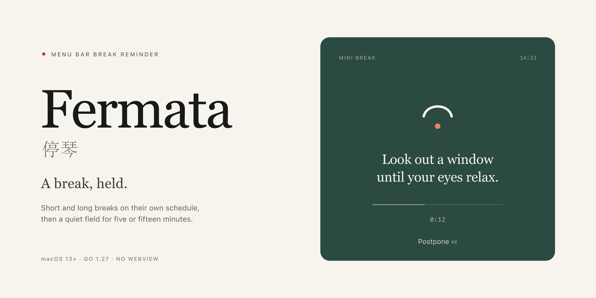
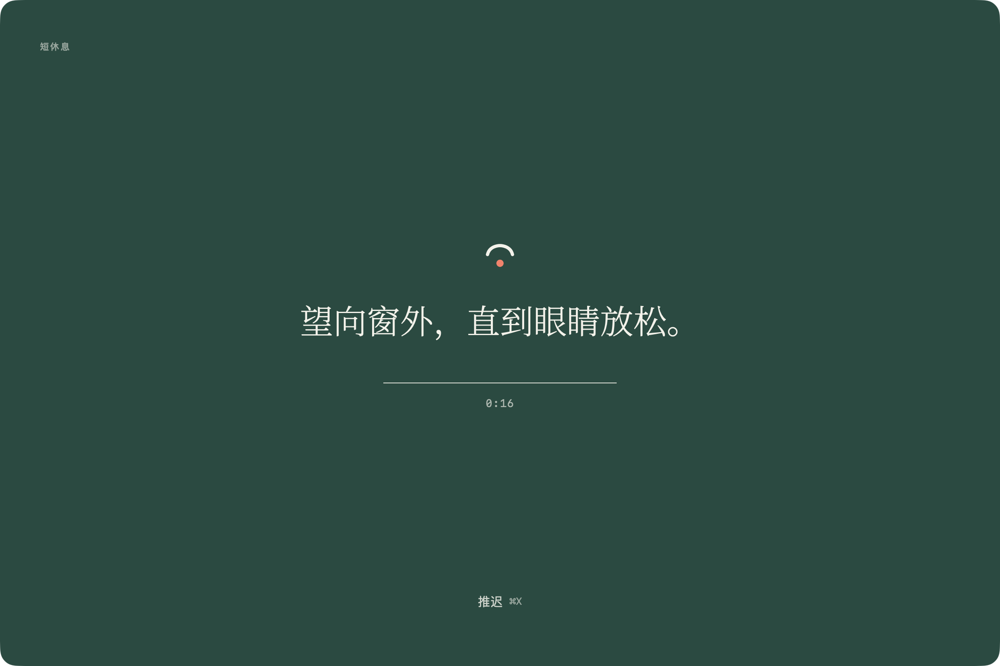
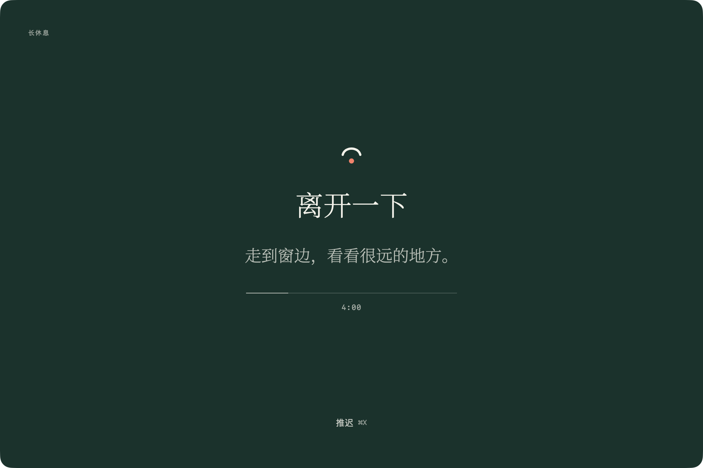
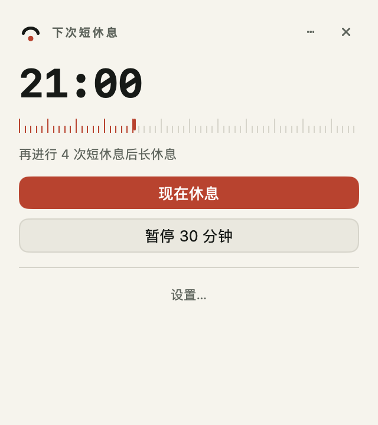
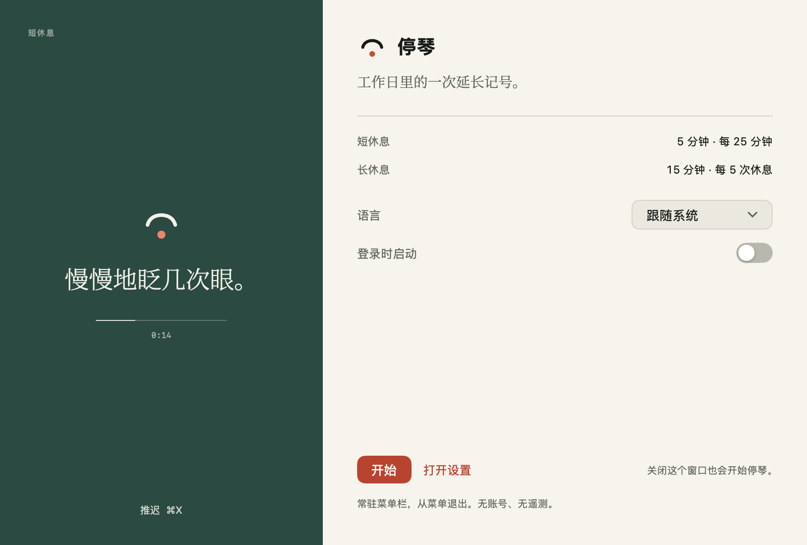
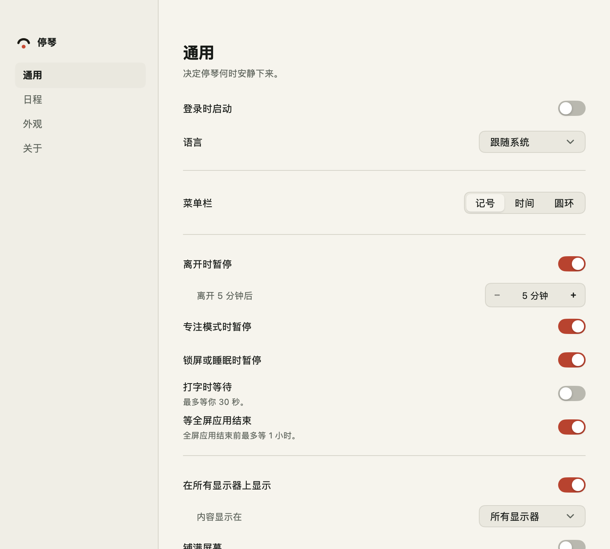
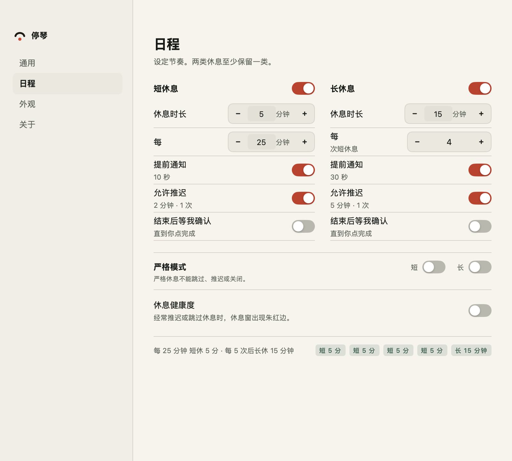
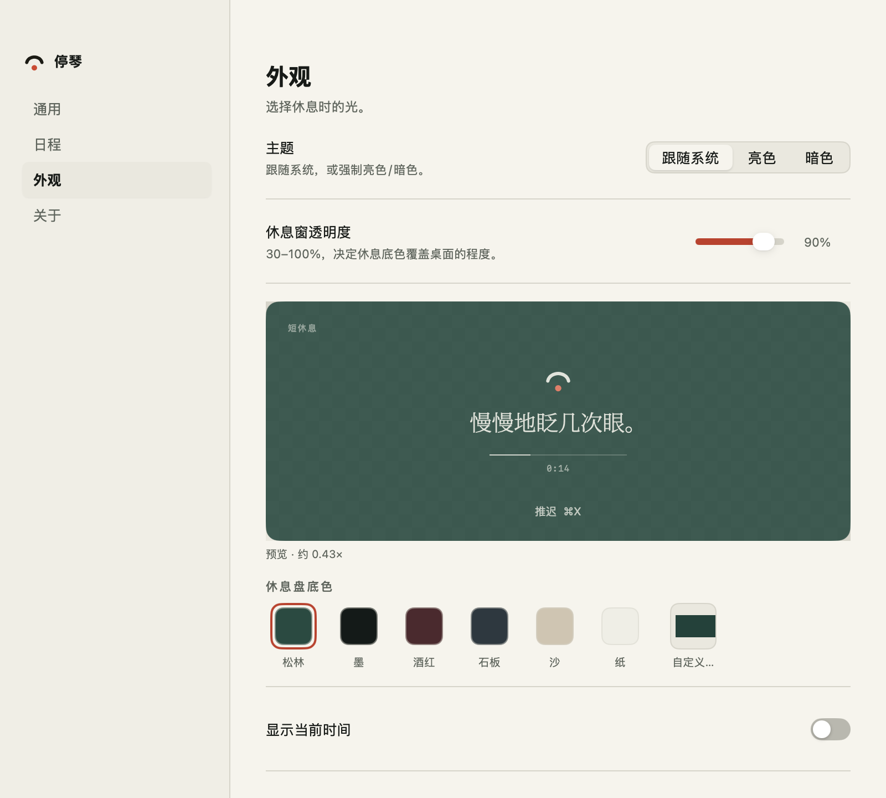
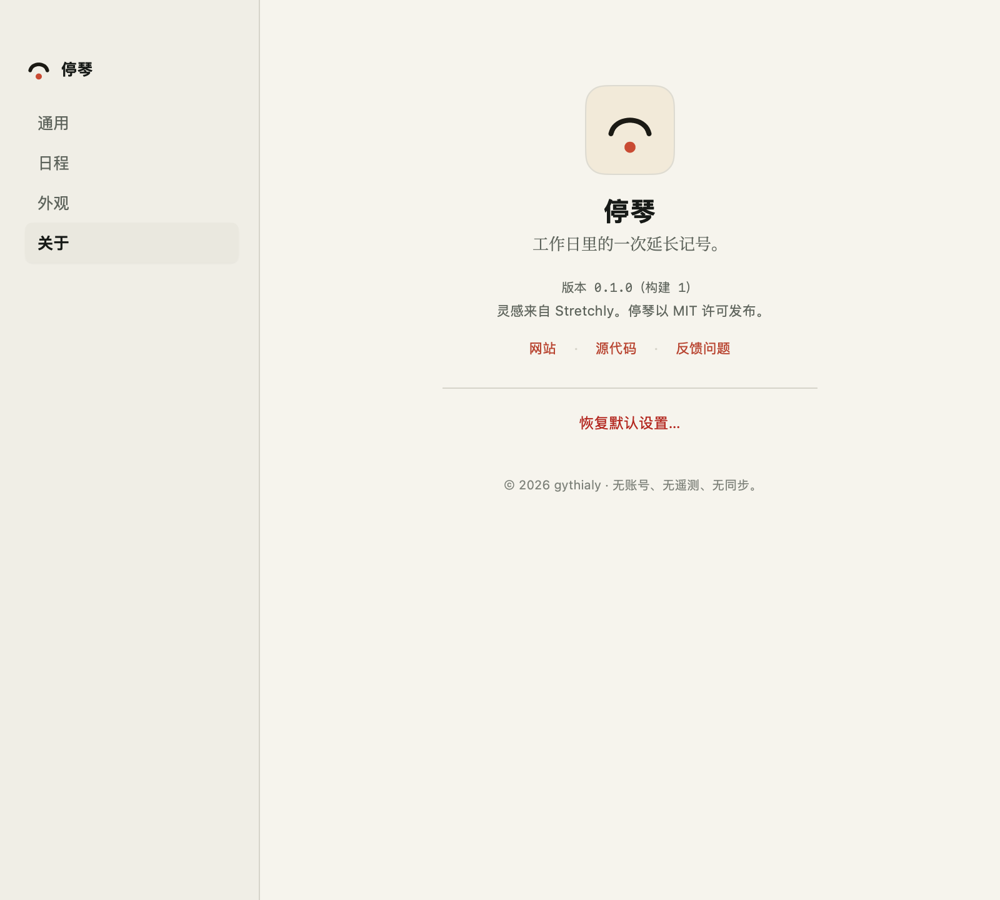

<p align="center">
  <a href="https://github.com/gythialy/fermata">
    
  </a>
</p>

# Fermata · 停琴

**菜单栏里的休息提醒。** 短休息和长休息按自己的节奏到来，占用几分钟屏幕，
然后安静地退回去。灵感来自 [Stretchly](https://github.com/hovancik/stretchly)，
用 Go 与 [MyGo](https://github.com/egoist/mygo) 写成：单进程、原生菜单栏、没有 WebView。

[English](README.md) · 简体中文

[](https://github.com/gythialy/fermata/blob/main/go.mod)
[](https://github.com/gythialy/fermata/actions/workflows/ci.yml)
[](https://github.com/gythialy/fermata/blob/main/LICENSE)
[](https://github.com/gythialy/fermata/blob/main/docs/development.md#requirements)
[](https://github.com/gythialy/fermata/actions/workflows/nightly.yml)

## 它能做什么

- **可坚持的节奏。** 默认番茄钟：每 25 分钟一次 5 分钟短休息，每四次短休息
  之后一次 15 分钟长休息。两种都可调，但至少保留一种。
- **一块休息的场，不是对话框。** 每块屏幕一个窗口，占屏幕 85%，里面只有
  延长记号、一条建议、一条随休息推进的发丝线、倒计时，以及同一时刻唯一的
  出口——`延迟`、然后`跳过`、然后等待你完成的`结束`。键盘上 `⌘X` 效果相同。
- **严格模式说到做到。** 不能延迟、不能跳过、不能关窗，休息结束前应用拒绝退出。
  锁屏或 Mac 睡眠仍会结束这次休息。
- **不必离开菜单栏就能暂停。** 30 分钟、1 小时、2 小时、5 小时、直到明早，
  或无限期。离开电脑、专注模式、锁屏、以及你排除的应用也会自动暂停。
- **到点的休息会等一等。** 前台应用全屏（最多 1 小时），或启用后你正在输入
  （最多 30 秒）时，休息暂缓，条件解除后以完整时长开始。全屏检测只读窗口边界，不需要屏幕录制权限。
- **安静而完整的设置。** 通用、日程、外观、关于；英文、简体中文或跟随系统；
  登录时启动；菜单栏样式（记号／时间／圆环）；休息场颜色与不透明度；声音与
  音量；应用排除；休息健康；恢复默认。
- **状态弹窗代替一长串菜单项。** 左键点图标（或休息预告）看倒计时和快捷操作；
  右键保留经典菜单。
- **等待中的倒计时会被记住。** 十分钟内重启应用，倒计时继续；休息进行中或
  暂停中则不恢复。
- **更新保持安静。** 后台查询 GitHub Releases，在「关于」里提示；不会自行下载
  或安装。

## 截图

<p align="center"></p>

长休息：一个标题、一块更深的场、十五分钟。

<p align="center"></p>

### 应用各处

| 状态弹窗 | 首次启动 |
|:-:|:-:|
|  |  |

### 设置

| 通用 | 日程 |
|:-:|:-:|
|  |  |

| 外观 | 关于 |
|:-:|:-:|
|  |  |

## 安装

macOS 13 或更新，通过 [Homebrew](https://brew.sh)：

```sh
brew tap gythialy/tap
brew install --cask fermata
```

cask 位于 [gythialy/homebrew-tap](https://github.com/gythialy/homebrew-tap)。
Fermata 为 ad-hoc 签名、未公证；cask 会清除下载隔离，若首次启动仍被 macOS
拦截，右键应用选择「打开」。更新用 `brew upgrade --cask fermata`。从源码构建见
[开发指南](https://github.com/gythialy/fermata/blob/main/docs/development.md)。

### Nightly（每夜构建）

每晚从 `main` 构建一个 DMG：未签名、未公证，可能随时是坏的。
[下载 Fermata-nightly.dmg](https://github.com/gythialy/fermata/releases/download/nightly/Fermata-nightly.dmg)。

## 名字的由来

*Fermata* 是乐谱上的延长记号：让一个音停得比写下的时值更久，乐队等着，然后继续。
中文名 **停琴** 取自南朝齐诗人谢朓《移病还园示亲属诗》：「停琴伫凉月，灭烛听归鸿。」
——停下琴弦，在凉月里站一会儿，吹灭蜡烛听归雁。两个名字说的是同一个动作；
记号里弧下的那一点，是按住琴弦的手指。

## 许可

MIT，见 [LICENSE](https://github.com/gythialy/fermata/blob/main/LICENSE)。Fermata
灵感来自 [Stretchly](https://github.com/hovancik/stretchly)（BSD-2-Clause），
未复用其代码；休息建议与声音是原创的。Spectral 与 Noto Serif SC 以
SIL Open Font License 1.1 分发。

## 文档

设计、行为与实现都写成了文档。从[文档索引](https://github.com/gythialy/fermata/blob/main/docs/README.md)开始，或直接进入：

| 文档 | 内容 |
|---|---|
| [产品](https://github.com/gythialy/fermata/blob/main/docs/product.md) | 目标、范围、决策、路线图与视觉画布 |
| [功能规范](https://github.com/gythialy/fermata/blob/main/docs/functional-spec.md) | 规范性的行为规则与验收用例 |
| [架构](https://github.com/gythialy/fermata/blob/main/docs/architecture.md) | 包结构、状态机、数据流、测试与构建 |
| [设计系统](https://github.com/gythialy/fermata/blob/main/docs/design-system.md) | Held Note v2：记号、令牌、组件与界面 |
| [开发](https://github.com/gythialy/fermata/blob/main/docs/development.md) | 运行、构建、安装、测试、命令行、i18n、素材 |

环境要求、从源码构建和完整命令行见[开发指南](https://github.com/gythialy/fermata/blob/main/docs/development.md)。
