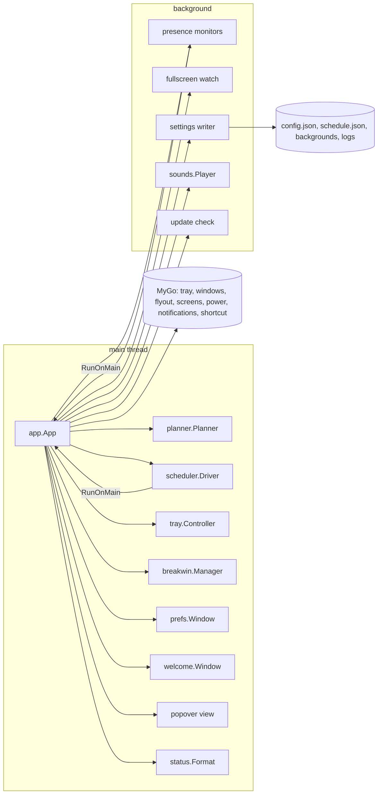
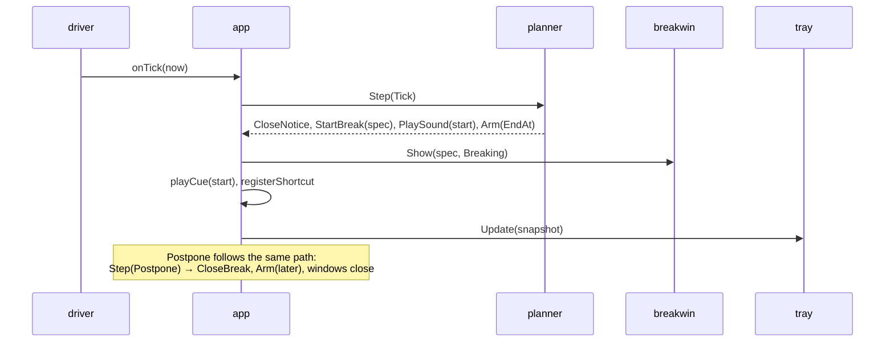
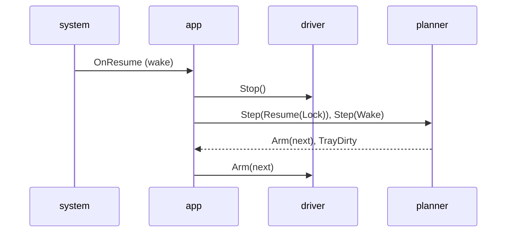

# Fermata (停琴) — software architecture

**Status:** As built — v1.1.2 · MyGo 0.10.0 · Go 1.27 · macOS 13+, Windows 11, Linux · one process, no cgo.

This document describes the code in this repository, not a plan for it. It answers: where
the code lives, who owns each piece of state, which thread does what, how it is tested, and
which behaviour still needs a real Mac to confirm. Everything after this line is English.

## Document map

| Document | What it is | Relation to this one |
|---|---|---|
| [functional-spec.md](functional-spec.md) | Normative behaviour: rules, states, acceptance cases | This document implements it; where they differ, the spec wins |
| [design-system.md](design-system.md) | Visual design: tokens, type, surfaces, components | This document explains how the app draws that system in MyGo |
| [product.md](product.md) | Scope, audiences, decisions, milestones | This document records what was built from it |
| [development.md](development.md) | Building, testing, signing, regenerating assets | This document explains the structure those commands build |
| [README.md](../README.md) | User-facing description | The shortest true statement of behaviour |

---

## 1. Goals and constraints

### 1.1 Goals

1. **A schedule a test can exhaust.** All timing lives in one pure state machine: inputs
   carry `now`, steps return effects, nothing reads a clock. Months of behaviour run in
   milliseconds.
2. **One main thread.** Windows, tray, menus, notifications and the planner are touched
   only on the main thread. Background goroutines wait, read the system, or write files,
   and hand results back with `mygo.RunOnMain`.
3. **Replaceable edges.** Idle, Focus, process lookup, the clock, sound and the file system
   are injected as structs of functions (`presence.Source`, `breakwin.Options`,
   `prefs.Options`, `welcome.Options`), so tests need no timers and no window server.
4. **Verifiable.** `go test ./...` covers the planner, settings, presence, CLI, status,
   icons and logging; `ui.NewTester` covers the break window, the four settings pages and
   the welcome window headlessly; build-tagged screenshot tests render `docs/images/`.
5. **Small.** A menu bar item, no webview, no cgo, runtime-drawn icons, embedded audio and
   embedded suggestion decks: one Go process.

### 1.2 Non-goals

- **Identical shells.** Each system keeps its own: the menu bar on macOS, the
  tray on Windows and Linux, with what each can offer hiding the rest (§22).
- **Accounts, sync, telemetry, automatic update install.** The update check reports a newer
  release; installing it stays a manual download.
- **A web frontend, plugins, scripting.** No WebView, no TypeScript, no UI build step.
- **Watching `config.json` externally.** The file is read at launch; a hand edit applies on
  the next launch (settings made in the app apply live).

---

## 2. What the framework gives (MyGo 0.10.0)

Read from the module this repository compiles against; the code uses no API this table does
not name.

| Capability | API used here | Behaviour that matters |
|---|---|---|
| Main-thread dispatch | `mygo.RunOnMain(fn)` | Returns to the main thread from any goroutine; dropped after exit |
| Tray | `mygo.NewTray(mygo.TrayOptions{ID, Icon, IconIsTemplate, Title, MonospacedTitle, ToolTip})`, `SetIcon`, `SetTitle`, `SetMenu`, `SetToolTip`, `OnClick`, `OnRightClick`, `PopUpMenu` | `ID` keeps the icon's place across launches; `Title` is macOS-only; template images are tinted by the system |
| Window | `mygo.NewWindow(mygo.WindowOptions{…})`, `ShowInactive`, `Invalidate`, `Close`, `Destroy`, `OnClose` | `Panel` floats above all apps on every Space, stays out of Dock and app switcher, and on macOS gives the keyboard without activating the app; also `Frameless`, `Transparent`, `Opacity`, `CornerRadius`, `BackgroundColor`, `StateKey`, `TitleBarStyle`, `Content` |
| Flyout | `mygo.NewFlyout(mygo.FlyoutOptions{Tray, Placement, Gap, Width, FitContent, MaxHeight, Focusable, Popover, Shadow, CornerRadius, Content})` | Anchors under a tray icon and follows it; `FitContent` sizes the panel to its content; Linux has no icon geometry, so a menu item opens it mid-screen |
| Displays | `mygo.Screen.Displays()`, `Display{Bounds, ID, Primary}`, `CursorScreenPoint()`, `DisplayNearestPoint()`, `OnDisplaysChanged` | `Bounds` are DIPs, negative on a left-hand display |
| Global shortcut | `mygo.GlobalShortcut.Register(acc, fn)`, `Unregister`, `UnregisterAll` | `CmdOrCtrl+X` parses per platform; a taken chord returns an error |
| Notifications | `mygo.NotificationsSupported()`, `mygo.NewNotification(NotificationOptions{ID, Title, Body, Silent}).Show()`, `App.OnNotificationClick` | No action buttons; only a bundled macOS app may post; refusal is `mygo.ErrNotificationsDenied`, learned on the first `Show` |
| Power and session | `mygo.Power.IdleTime()`, `OnSuspend`, `OnResume`, `OnLockScreen`, `OnUnlockScreen` | Callbacks arrive on the main thread; `IdleTime` is zero where the system will not say |
| App lifecycle | `App.SetName`, `App.SetActivationPolicy(ActivationPolicyAccessory)`, `App.SetMenu`, `WhenReady`, `Run`, `Quit`, `OnBeforeQuit`, `OnWindowAllClosed`, `OnLocaleChanged` | `OnWindowAllClosed` must be registered or MyGo quits with the last window; `QuitEvent` carries `SessionEnding` and `PreventDefault` |
| Single instance | `App.RequestSingleInstanceLock()`, `App.OnSecondInstance(func(args []string, wd string))` | The second process forwards argv and exits |
| Locale | `App.SetLocale`, `App.Locale`, `App.Region().HourCycle` | Empty tag means the system; the region gives 12/24-hour clock |
| Login item | `App.SetOpenAtLogin(bool) error` | Needs a bundled `.app` on macOS |
| Theme | `mygo.Theme.IsDark()`, `mygo.Theme.SetSource(ThemeSource("system"\|"light"\|"dark"))` | Window appearance follows the source |
| Paths | `App.Path(PathUserData)`, `App.Path(PathLogs)` | Per-user data and log directories |
| Native UI | `ui.View(func(c *ui.Context))`, `*ui.Context` | A view is rebuilt each frame; elements do not survive it; `c.Now()`, `c.After(d)`, `c.Theme()`, `c.Preferences().TextScale`, `c.SetTheme` |
| Fonts | `ui.RegisterFont(data, family)` | Registers TTF/OTF under the family the stacks name |
| Dialogs | `mygo.Dialog.Message(MessageOptions{Type, Title, Message, Buttons, DefaultButton, CancelButton})` | Native question box; returns the chosen index |
| Shell | `mygo.Shell.OpenExternal(url)` | Opens the About links |
| Headless UI | `ui.NewTester(view, w, h)`, `Frame`, `Advance`, `Now`, `SetSize`, `SetScale`, `Image`, `Texts`, `HasText`, `AccessAll`, `ClickAt` | Renders and drives a view with a virtual clock, no window server |

Limits this design works within:

- **Elements are per-frame.** Only `ui.Handle` may be kept. State lives in the app or in a
  window struct, never in an element or a `*ui.Context`.
- **Menu items update in place.** `SetLabel`, `SetSubtitle`, `SetVisible`, `SetEnabled`
  change an open menu without closing it; rebuilding a `Menu` closes it.
- **The tray has no title on Windows.** The time style is not offered there.
- **Notification permission is not queryable.** `NotificationsSupported` reports whether
  the platform can post at all, not whether the user agreed.
- **A panel still needs measuring on device.** `Panel` + `ShowInactive` is the mechanism;
  whether a click activates Fermata on a given macOS version is hardware-verified only.
- **One window listener is mandatory.** Without `App.OnWindowAllClosed(func(){})`, closing
  the welcome or settings window ends the process — MyGo's default for the last window.

---

## 3. Overview



### 3.1 One-way data flow

```
timer / command / settings / presence / user action
        ▼
planner.Step(input) ──► []Effect ──► app.apply
        ▼                              ▼
   new State              Arm, Disarm, Notify, CloseNotice, StartBreak,
                          CloseBreak, PlaySound, NotifyResume, TrayDirty
                                         ▼
                          windows · tray · notification · sound
```

Views never move the schedule. A control reports an intent (`Postpone`, `Skip`, `Finish`,
`Pause`, `Advance`, `Defer`, `Reset`, `SkipTo`); the coordinator turns it into an input and
the new state flows back into the view on the next frame.

---

## 4. Package structure

Twenty-seven packages under `internal/`, assembled by `main`.

```
fermata/
├── main.go            process entry: app name/policy/menu, CLI, single instance, Run
├── Makefile           build, dmg, run, test, test-race, vet, fmt, check, icons,
│                      screenshots, assets, clean
├── mygo.json          bundle identity, icon, i18n source
├── locales/           en.json, zh-Hans.json, generated catalog_gen.go
├── resources/         icon.png (fallback), tray.png
├── icons/             AppIcon.icon (Icon Composer) and compiled AppIcon.car
├── tools/             genicons, gensounds, fonts/subset.py, banner
├── docs/              this document, its siblings and rendered screenshots
└── internal/
    ├── app/           coordinator: Start, effects, commands, config, holds, panels,
    │                  schedule state, labels, environment
    ├── planner/       pure state machine: planner, state, input, effects, config, schedule
    ├── scheduler/     the one deadline timer, generation-guarded
    ├── settings/      config.json: settings, store, validate, migrate
    ├── presence/      presence, source, dnd_darwin/dnd_other, ps_unix/ps_other
    ├── fullscreen/    fullscreen (pure decision), fullscreen_darwin (CGWindowList)
    ├── overlay/       cover_darwin: a break field over the menu bar and the Dock
    ├── breakwin/      manager, view
    ├── prefs/         window, rows, general, schedule, appearance, about
    ├── welcome/       window (one page, one decision)
    ├── popover/       the flyout's view (the window belongs to the app)
    ├── tray/          tray, menu
    ├── trayicon/      runtime-drawn mark, pause bars, progress ring, cache
    ├── status/        state → tray words, pure
    ├── savedstate/    schedule.json across a quick restart
    ├── notify/        system notifications, one at a time
    ├── sounds/        embedded WAVs and playback
    ├── ideas/         embedded suggestion decks, shuffle bags
    ├── cli/           argument and duration parsing, help, version
    ├── theme/         Held Note theme, field colors, font stacks, text scale
    ├── mark/          the fermata: one geometry for every surface
    ├── icons/         drawn glyphs on a 16-unit grid
    ├── fonts/         embedded Spectral + Noto Serif SC subsets
    ├── units/         duration wording for steppers and summaries
    ├── update/        GitHub Releases check
    ├── shortcut/      the break shortcut's label per platform
    ├── paths/         user data, config, schedule, backgrounds, logs, migration
    └── logging/       slog text handler with 1 MB × 3 rotation
```

Dependency direction, which the import graph keeps acyclic:

```
main        → app, cli, locales, mygo
app         → planner, scheduler, settings, presence, fullscreen, status, tray, trayicon,
              breakwin, prefs, welcome, popover, notify, sounds, ideas, cli, theme,
              paths, logging, update, fonts, locales, mygo, ui
breakwin    → planner, settings, theme, ideas, status, shortcut, mygo, ui
prefs       → settings, theme, icons, units, locales, mygo, ui
welcome     → settings, theme, ideas, shortcut, units, locales, mygo, ui
popover     → theme, icons, locales, ui
tray        → planner, status, mygo
theme       → mark, settings, ui
mark, icons → ui
paths       → settings, mygo
units       → locales
planner, settings, cli, logging, savedstate, update, shortcut, trayicon → stdlib only
```

`planner` imports only the standard library, never `mygo`, `ui` or the clock: each input
carries its own `time.Time`. That is what lets the whole schedule be tested without a
framework, a window or a timer.

---

## 5. The planner

`internal/planner` is the schedule and the only place that decides anything about time.

### 5.1 Types

```go
type Kind uint8
const (Mini Kind = iota + 1; Long)

type Phase uint8
const (
    Preparing   Phase = iota // before the first schedule, or while welcome is open
    Waiting                  // before the next break, or its notice
    Notified                 // the notice went out; the break is next
    Breaking                 // the break counts down
    ManualAwait              // the countdown ended; the break waits for the user
    Paused                   // no schedule, because of at least one reason
)

type Reason uint8   // a set: Has, With, Without, Empty, Primary, String
const (Manual Reason = 1 << iota; DND; Idle; Lock; Exclusion)

type State struct {
    Phase Phase; Kind Kind
    N int                      // number of the next break, from 1
    NotifyAt, BreakAt time.Time
    StartAt, EndAt time.Time; Duration time.Duration
    Postpones int
    Reasons Reason
    PauseUntil time.Time       // timed manual pause; zero = indefinite
    Strict, ManualFinish bool
    Missed bool                // diagnostic only
    // unexported: anchor, force *Kind, restart *breakOverride,
    //             title/text (next break), curTitle/curText, postpone
}

type BreakSpec struct {        // the running break's snapshot
    Kind Kind; Number int
    StartAt, EndAt time.Time; Duration time.Duration
    Strict, ManualFinish bool
    Postpone PostponeConfig
    Title, Text string         // CLI overrides for this break only
}

type Config struct {
    Mini, Long BreakConfig     // Enabled, Duration, Interval, Notify, Lead, Postpone, Strict, ManualFinish
    EveryNBreaks int
    PauseDurations []time.Duration
    MorningHour int
}
type PostponeConfig struct { Enabled bool; Time time.Duration; Limit, Percent int }
```

`BreakSpec` is a snapshot taken when the break starts: a settings change never reshapes a
running break, and a postponement carries the same snapshot to the new start
(`State.restart`), so a postponed break is still the same break.

Inputs (15): `Tick`, `Wake`, `Pause{Now, Reason, Until}`, `Resume{Now, Reason}`,
`Postpone`, `Skip`, `Finish`, `Show`, `Restore{Now, N, BreakAt, NotifyAt}`, `Advance`,
`Defer{Now, By}`, `Reset`, `SkipTo{Now, Kind, Delay, Title, Text}`,
`NextText{Now, Title, Text}`, `SetConfig{Now, Config}`.

Effects (9): `Arm{At}`, `Disarm`, `Notify{Kind, Lead}`, `CloseNotice`, `StartBreak{Spec}`,
`CloseBreak{Reason}`, `PlaySound{Name}` (`start`/`end`), `NotifyResume`, `TrayDirty`. Close
reasons: `Completed`, `Postponed`, `Skipped`, `Interrupted`.

### 5.2 One step

`Step(in Input) []Effect` applies the input, then every deadline that is due:

1. **Apply the input** (`Tick`/`Wake` change nothing themselves; each other input has its
   rule in §5.3).
2. **Advance due deadlines**, in a loop bounded at eight iterations:
   - `Paused`: an expired timed manual pause removes `Manual`; when that was the last
     reason, schedule break 1 from `now` and emit `NotifyResume`.
   - `Waiting`: `now >= BreakAt` starts the break if it is at most `lateGrace` (2 s) late; a
     later deadline is a **miss** — the break is not shown, `N++`, the wait is rescheduled
     from `now`, `Missed` is set. A due `NotifyAt` emits `Notify` and moves to `Notified`.
   - `Notified`: `now >= BreakAt` starts the break, same 2 s rule.
   - `Breaking`: `now >= EndAt` ends it (below).
3. **Add the deadline** unless the effects already carry one: the earlier of `NotifyAt` and
   `BreakAt` in `Waiting`, `BreakAt` in `Notified`, `EndAt` in `Breaking`, `PauseUntil` for a
   timed manual pause, otherwise `Disarm`.
4. **Add `TrayDirty`** when the state signature changed. The signature is
   `phase|kind|reasons|n|strict|manualFinish`: time-only changes do not repaint the menu,
   because the app refreshes the countdown from its own timer.

`Wake` is `Tick` with zero grace, so a system sleep can never produce a break that should
have happened with the lid closed. Ending a break has two shapes:

- `ManualFinish`: play the end sound and move to `ManualAwait` — no deadline, the window
  stays, the exit becomes *Finish*.
- Otherwise: `CloseBreak(Completed)`, play the end sound, `N++`, clear `Postpones`. If a
  pause reason arrived during the break, the app becomes `Paused` with `N=0`. Otherwise the
  next wait starts at `EndAt`, unless the app noticed the end more than 2 s late, in which
  case it starts at `now`.

### 5.3 Input semantics

| Input | Preconditions | Result |
|---|---|---|
| `Pause(reason, until)` | any; a strict break ignores every reason except `Lock` | Adds the reason. `Manual`/`Lock` close the notice and, if a break runs, `CloseBreak(Interrupted)`; `N=0`, `Paused`, `Manual` records `Until`. `DND`/`Idle`/`Exclusion` pause a waiting app at once; during a break they decide what follows it |
| `Resume(reason)` | `Paused` with that reason set | Removes it. Reasons left → nothing more; none left → schedule break 1 from `now`, and `NotifyResume` only for `Manual` |
| `Postpone` | `Breaking`, not strict, `CanPostpone` | `CloseBreak(Postponed)`, `Postpones++`, keep the snapshot, re-schedule the same break `Postpone.Time` later (notice only if the delay exceeds the lead). A reason set → `Paused`, `N=0` |
| `Skip` | `Breaking`, not strict, **not** postponable | `CloseBreak(Skipped)`, `N++`, reschedule or pause. Postponing and skipping are mutually exclusive: the window offers exactly one exit |
| `Finish` | `ManualAwait` | `CloseBreak(Completed)`, `N++`, reschedule or pause |
| `Show` | `Waiting`/`Notified`, already due | Starts the break now at full duration, ignoring the miss rule (releases a held break) |
| `Advance` | `Waiting`/`Notified` | Starts the next break now, keeping its kind and place in the sequence |
| `Defer(by)` | `Waiting`/`Notified`, `by > 0` | Closes the notice, sets `BreakAt = max(BreakAt, now)+by`, recomputes the notice, arms the earlier of the two |
| `Reset` | not strict | Closes notice and break, `N=0`, `Postpones=0`; a paused app stays paused, otherwise schedule break 1 from `now` |
| `SkipTo(kind, delay)` | not paused, not strict, kind enabled | Closes what is open, sets the kind's sequence slot (`Long` → `EveryN+1`; `Mini` in a long slot → 1), arms `now+delay` with `force` set so the break starts as that kind whatever `N` says. `delay` defaults to 100 ms |
| `NextText(title, text)` | any | Overrides the next break's idea without starting anything |
| `Restore(N, BreakAt, NotifyAt)` | `Preparing`, or `Waiting` with no deadline | Resumes a saved schedule; a notice already past is dropped; the deadline is the earlier of notice and break |
| `SetConfig` | any | Replaces the configuration. `Waiting` is recomputed from its anchor (a notice that would now be late is dropped); `Notified` keeps the kind and notice it announced and only moves the break; `Breaking`/`ManualAwait` keep their snapshot |

Scheduling arithmetic (`schedule`, `schedulePostponed`):

- `kind = KindFor(n)`: with both kinds on, break `n` is long when `n % (EveryN+1) == 0`;
  with one kind on, every break is that kind; `force` overrides during a `SkipTo`.
- `gap = Mini.Interval` while mini breaks are on, else `Long.Interval` (a non-positive gap
  falls back to one minute).
- `lead = BreakConfig.LeadTime()` — zero when the notice is off — capped at `gap/2`.
- `notifyAt = breakAt - lead` (zero when there is no notice).
- A postponed break waits `Postpone.Time` from `now`, keeping the notice only if the delay
  is longer than the lead.

### 5.4 Invariants

`State.validate()` runs in tests and in the random walk:

- `Waiting` has a `BreakAt` and `N >= 1`; `Notified` has both `BreakAt` and `NotifyAt`.
- `Breaking` has `StartAt`, `EndAt`, `Duration > 0` and `EndAt == StartAt + Duration`.
- `ManualAwait` exists only with `ManualFinish`, and has the break's start and duration.
- `Paused` has a non-empty reason set; a non-empty set outside `Paused` is allowed only for
  `Breaking`/`ManualAwait` (a reason that arrived mid-break).
- A step emits at most one `StartBreak` and at most one `CloseBreak`.
- Effect order: input effects, deadline effects, `Arm`/`Disarm`, `TrayDirty`.
- `N` never decreases inside a sequence; `Postpones` resets when the sequence moves on.

### 5.5 Tests

`planner_test.go` is table-driven over a fixed UTC clock, with a default config of 20 s mini
breaks every 10 minutes and 5-minute long breaks every third break. It covers the default
sequence, mini-only, long-only, `EveryN` 1 and 30, notices off, a lead longer than the gap,
postponement at 0/30/31 percent and after the limit, skip, strict, manual finish, every pause
reason, resume, sleep across a cycle, config changes during a wait and a break, reset,
`SkipTo`, `last`, restore, and effect order. A seeded 3000-step random walk
(`TestRandomInputsKeepsInvariants`) feeds random inputs at random times and asserts
`validate()` after every step.

---

## 6. The scheduler

`internal/scheduler.Driver` owns the only timer a schedule needs.

```go
type Driver struct {
    mu sync.Mutex; gen uint64; timer *time.Timer; stopped bool
    fire func(time.Time)
    dispatch func(func())   // mygo.RunOnMain in the app, direct in tests
    now func() time.Time
}
func New(fire func(time.Time)) *Driver
func (d *Driver) Arm(at time.Time)   // replaces the deadline
func (d *Driver) Stop()              // cancels it
func (d *Driver) Close()             // stops for good; a due callback does nothing
```

- Every `Arm`, `Stop` and `Close` increments `gen`; a callback whose generation is stale, or
  whose driver is closed, is discarded. A late timer cannot start a break twice.
- `Arm` clamps a deadline in the past to a zero delay, so "already due" fires on the next
  main-thread turn instead of never.
- The callback hops to the main thread with `dispatch` before calling `fire`, so the planner
  stays single-threaded.
- Sleep and wake: `Power.OnResume` stops the driver, steps `Wake` (zero grace) and arms what
  the new state asks for.
- Why not a ticker: there is exactly one deadline at a time, and `time.AfterFunc` means no
  wake-ups between deadlines.

---

## 7. Settings

`internal/settings` owns `config.json`: its shape, defaults, repairs and a writer that never
lets a slider block a frame. It imports only the standard library; the app converts a
snapshot into `planner.Config`, so the planner never sees this package.

### 7.1 Shape and defaults

The file is one object. The values below are what a first run writes
(`settings.Default()`), with `version` 2 and `isFirstRun` true:

```json
{
  "version": 2,
  "general": { "openAtLogin": false, "language": "system", "theme": "system",
               "menuBarStyle": "mark", "showTrayMenuInStrictMode": false },
  "schedule": {
    "mini": { "enabled": true, "durationMs": 300000, "intervalMs": 1500000,
              "notify": true, "notifyLeadMs": 10000,
              "postpone": { "enabled": true, "timeMs": 120000, "limit": 1, "percent": 30 },
              "strict": false, "manualFinish": false },
    "long": { "enabled": true, "durationMs": 900000, "everyNBreaks": 4,
              "intervalMs": 6000000, "notify": true, "notifyLeadMs": 30000,
              "postpone": { "enabled": true, "timeMs": 300000, "limit": 1, "percent": 30 },
              "strict": false, "manualFinish": false },
    "pauseDurationsMs": [1800000, 3600000, 7200000, 18000000], "morningHour": 6
  },
  "presence": {
    "idle": { "enabled": true, "resetAfterMs": 300000, "checkIntervalMs": 2000 },
    "dnd": { "enabled": true, "checkIntervalMs": 2000 },
    "pauseOnLock": true, "fullscreen": true, "waitWhileTyping": false, "appExclusions": []
  },
  "breakWindow": { "allScreens": true, "screen": "primary", "contentScreen": "all",
                   "fillScreen": false, "widthRatio": 0.85, "heightRatio": 0.85,
                   "field": "pine", "customField": "#24413A",
                   "showIdeas": true, "showCurrentTime": false,
                   "transparent": false, "opacity": 0.9, "backgroundImage": false },
  "sound": { "muted": false, "volume": 1, "miniStart": "silence", "longStart": "silence",
             "miniEnd": "crystal-glass", "longEnd": "crystal-glass" },
  "shortcuts": { "endBreak": "CmdOrCtrl+X" },
  "health": { "mode": false },
  "isFirstRun": true
}
```

That is the Pomodoro rhythm the README describes: a five-minute mini break every twenty-five
minutes, and a fifteen-minute long break after every four mini breaks (`everyNBreaks: 4`
means the *fifth* break is long). Durations are integer milliseconds everywhere.

| Member | Values |
|---|---|
| `general.language` | `system`, `en`, `zh-Hans` |
| `general.theme` | `system`, `light`, `dark` |
| `general.menuBarStyle` | `mark`, `time`, `progress` |
| `breakWindow.screen` | `primary`, `cursor`, or a display index as a string |
| `breakWindow.contentScreen` | `all`, `primary`, `cursor`, or an index |
| `breakWindow.field` | `pine`, `ink`, `oxblood`, `slate`, `sand`, `paper`, `custom` |
| `sound.*` names | `silence`, `crystal-glass`, `wind-chime`, `tic-toc`, `reverie` |
| `presence.appExclusions[].rule` | `pause`, `resume` |

`transparent` and `backgroundImage` are read from the file but have no control in the UI;
`opacity` is read and also controlled by the appearance page.

### 7.2 Loading, validation, migration

`Load(path) (*Store, []string, error)`:

- **No file / empty file:** the defaults are written, with a warning.
- **Unparseable:** the file is renamed to `config.json.corrupt.<timestamp>.json`
  (counter-disambiguated), defaults replace it, `isFirstRun` becomes false so the welcome
  window does not reappear, and the About banner explains it.
- **Parseable:** known top-level members decode into the struct; every unknown top-level
  member is kept in `Extra map[string]jsontext.Value` and written back, so a newer version's
  settings survive a round trip through an older build.
- Either way the file is rewritten in canonical form (deterministic key order, two-space
  indent).

`Validate()` never rejects a configuration; it clamps and repairs, returning one warning per
repair (only an unreadable file sets the app's `corrupt` banner):

| Member | Accepted range / repair |
|---|---|
| `schedule.mini.durationMs` / `intervalMs` | 10–600 s / 300–3 900 s |
| `schedule.long.durationMs` / `intervalMs` | 60–3 600 s / 600–7 200 s |
| `schedule.long.everyNBreaks` | 1–30 |
| `schedule.*.notifyLeadMs` | 1–60 s, then capped at half the gap |
| `schedule.*.postpone` | `timeMs` 60 s–3 600 s, `limit` 0–5, `percent` 0–100 |
| `schedule.pauseDurationsMs` | non-empty, each 60 s–24 h |
| `schedule.morningHour` | 0–23 |
| `presence.idle.resetAfterMs` | 60 s–3 600 s; both check intervals forced to 2 000 ms |
| `breakWindow` | ratios 0.5–1, opacity 0.3–1, custom field `#rrggbb` else `#24413A` |
| `sound.volume` | 0–1; every sound name must be known |
| `shortcuts.endBreak` | non-blank, else `CmdOrCtrl+X` |

It also keeps at least one break kind on (mini returns if both are off), falls back for an
unknown language, theme, menu-bar style, field, screen, sound or rule, drops an exclusion
rule without a name or processes, and shortens a notice lead that does not fit its gap.

`migrate.go` brings a v1 file to v2: if the schedule still holds the old draft's values
exactly (20 s mini every 10 minutes, 5-minute long, every third break) it is replaced with
the current defaults — a schedule the user changed is left alone; `waitWhileTyping` is turned
off, because a long typing hold was easy to mistake for a stuck app; `version` becomes 2.

### 7.3 The store and its writer

```go
func Load(path string) (*Store, []string, error)     // reads, repairs, starts the writer
func New(path string, s Settings) *Store              // tests, or settings in hand
func (st *Store) Get() *Settings                      // live struct, bound to views
func (st *Store) Update(fn func(*Settings)) []string  // change + validate + queue a save
func (st *Store) Touched() []string                   // after a bound control changed
func (st *Store) OnChanged(fn func())                 // after every change, main thread
func (st *Store) OnWriteError(fn func(error))         // on the writer goroutine
func (st *Store) Flush() error                        // write what is pending
func (st *Store) Close() error                        // flush and stop the writer
```

- **Debounce.** A change hands an encoded snapshot to a one-slot channel; the writer waits
  `SaveDelay` (150 ms) after the last one, drains the channel and writes only the newest.
  Dragging a slider across a hundred values writes once.
- **Flush is ordered.** `Flush` asks the writer for a round trip; the writer first drains
  every snapshot queued before the flush, so quitting never saves a stale value.
- **Atomic replace.** `writeAtomic` creates `.config-*.json.tmp` in the same directory,
  writes, `chmod 0644`, `fsync`, closes, then renames over the target. A failure leaves the
  previous file intact and reports through `LastWriteError`, the write-error callback and one
  settings banner.
- **Threading.** `Get`, `Update`, `Touched` and binding run on the main thread; the writer
  goroutine sees bytes only, never `*Settings`.

---

## 8. Presence and holds

`internal/presence` watches the system for what should pause or delay breaks. It reports
events and nothing else: the coordinator decides what an event means to the planner. The
fullscreen watch lives in the app, not here.

### 8.1 Events and the manager

```go
type Event struct { Kind Kind; At time.Time; Detail string }
// Kind: IdleEnter, IdleLeave, DNDEnter, DNDLeave, Lock, Unlock, Suspend, Resume,
//       ExclusionEnter, ExclusionLeave, Unavailable

type Config struct {
    IdleEnabled bool; IdleReset time.Duration
    DNDEnabled  bool; Rule *Rule
    PollInterval time.Duration
}
type Rule struct { Name string; Processes []string; Pause bool }
```

`Manager` owns the probes. `Start` launches one goroutine per monitor (idle, Focus,
exclusions), each on its own ticker, plus the power subscriptions when `Source.Power` is set.
Every reading is posted to the main thread with `Source.Dispatch` before it becomes an event,
so all manager state (`away`, `idlePaused`, `dndOn`, `excluded`) is main-thread state and
needs no lock. `Configure` swaps the watched configuration and, when a watched thing is
turned off mid-pause, emits the matching "leave" event so the app can resume.

### 8.2 The probes

| Probe | Implementation | Period | Degradation |
|---|---|---|---|
| Idle | `mygo.Power.IdleTime()`; away at 20 s, paused at `resetAfterMs` (default 5 min) | `checkIntervalMs` (2 s) | A zero reading means "not away": no pause |
| Focus / Do Not Disturb (macOS) | `presence.ProbeDND`: `~/Library/DoNotDisturb/DB/Assertions.json` (non-empty `storeAssertionRecords` = on), else `defaults -currentHost read com.apple.notificationcenterui doNotDisturb` | 2 s | An unreadable probe stops for the run, emits one `Unavailable`, counts as off |
| Focus availability | `presence.FocusReadable()`: the assertion file (or its directory) must be readable | once at start, again on every settings change | False hides the Focus row; the app never asks for Full Disk Access |
| Lock, sleep, wake | `Power.OnLockScreen`, `OnUnlockScreen`, `OnSuspend`, `OnResume` | system push | Not applicable |
| App exclusion | `presence.RunningProcesses`: `ps -axo comm=,args=` and a lower-cased substring match over the first active rule | 2 s | A failed listing counts as "not running", warned once |
| Fullscreen (app-side) | `fullscreen.Active(displays, pid)`: `CGWindowListCopyWindowInfo` through `purego`, bounds/owner/layer only | 2 s when the setting is on, 15 s when off | Failure counts as "not fullscreen", logged once |

macOS 13 and later protect the assertion file, so `FocusReadable` is false until the user
grants Full Disk Access by hand, and the setting is hidden rather than failing silently. When
a probe errors, `dndBroken` latches until the next `Configure` (that is, until the user
changes something in settings), so the app does not spawn a `defaults` process every two
seconds against a permission that will not change.

The fullscreen decision is pure and testable: windows are ordered front to back; the first
normal-layer window (layer 0, not Fermata's own, at least 100 pt on a side) decides; it
counts when its rectangle matches a display within 2 pt, which tolerates rounded corners and
window managers that inset a point. A fullscreen window behind a normal window therefore
does not count.

### 8.3 What the app does with an event

| Event | Planner input |
|---|---|
| `IdleEnter` | `Pause{Reason: Idle}` |
| `IdleLeave` | `Resume{Reason: Idle}`, then `Tick` |
| `DNDEnter` | `Pause{Reason: DND}` |
| `DNDLeave` | `Resume{Reason: DND}`, then `Tick` |
| `Lock`, `Suspend` | `Pause{Reason: Lock}` when `pauseOnLock` is set |
| `Unlock` | `Resume{Reason: Lock}` when `pauseOnLock` is set, then `Tick` |
| `Resume` (wake) | `Resume{Reason: Lock}` when `pauseOnLock` is set, then `Wake` |
| `ExclusionEnter` / `ExclusionLeave` | `Pause`/`Resume{Reason: Exclusion}`, then `Tick` on leave |
| `Unavailable` | Nothing: one log line, no dialog |

Probes report only crossings, and `planner.Reason` is a set, so the same reason twice is a
no-op. An automatic reason ends when its probe says so; a manual pause ends at its `Until`.

### 8.4 Holds: the two ways a due break waits

A break that is due does not always start. Two settings can delay it; unlike a pause, a
hold ends when the reason ends and the break then runs at full length.

| Hold | Condition | Cap | Release |
|---|---|---|---|
| Fullscreen (`holdFullscreen`) | `presence.fullscreen` and a normal window covers a display | 1 hour | Next poll, or at once when the watch sees fullscreen end |
| Typing (`holdTyping`) | `presence.waitWhileTyping`, a break (not a notice) is due, and `IdleTime() < 500 ms` | 30 seconds | Next poll without input, or the cap |

```go
// app/hold.go, pure and table-tested
func holdDecision(phase planner.Phase, breakAt, notifyAt, now time.Time,
                  presence settings.Presence, fullscreen, typing bool) string
```

- A held break polls every 2 s (`holdPoll`); on release it steps `Show`, which starts the
  break now at full duration, ignoring the 2 s miss rule.
- The notice is closed while a break is held, so the user is not told "starting" and then
  shown nothing.
- Any real user command clears the hold; `Tick`, `SetConfig` and `NextText` do not, because
  they do not move the break.
- The tray says the break is waiting for a fullscreen app; a typing hold keeps the normal
  wording, since it lasts at most thirty seconds.
- The fullscreen watch is macOS-only, starts after everything else is built and re-arms
  itself; turning the setting off slows it to a 15 s look rather than stopping it, so
  enabling it later needs no restart.

> The cap is `typingHoldLast = 30 * time.Second`, matching the Settings help
> string ("Waits up to 30 seconds while you type").

---

## 9. The coordinator

`internal/app` is the only package that steps the planner and the only one that performs
effects.

### 9.1 What it owns

```go
type App struct {
    opts Options; log *slog.Logger; logs io.Closer
    store *settings.Store; pl *planner.Planner; drv *scheduler.Driver
    tray *tray.Controller; breaks *breakwin.Manager
    prefs *prefs.Window; welcome *welcome.Window
    pres *presence.Manager; notifier *notify.Notifier
    sounds *sounds.Player; ideas *ideas.Deck
    // plus: lastSpec/lastIdea, previewIdea, danger (health), started, welcomeOpen,
    // pending commands, quitting, corrupt, popover + timer, shortcut state, tray timer,
    // update timer, hold state and fullscreen watch, background pool, login/locale/focus
    // caches, the saved-state path, update results
}
```

No `ui.Element`, `ui.Handle` or `*ui.Context` is stored anywhere in it.

### 9.2 Effects

```go
func (a *App) apply(effects []planner.Effect) {
    switch e := effect.(type) {
    case planner.Arm:          a.drv.Arm(e.At)
    case planner.Disarm:       a.drv.Stop()
    case planner.CloseNotice:  a.notifier.Close()
    case planner.Notify:       a.notice(e)            // id break-mini / break-long
    case planner.StartBreak:   a.hidePopover(); a.startBreak(e.Spec)
    case planner.CloseBreak:   a.closeBreak(e.Reason)
    case planner.PlaySound:    a.playCue(e.Name)      // cue + kind → settings sound
    case planner.NotifyResume: a.notifier.Show("resume", …)
    case planner.TrayDirty:    // nothing: the tray refreshes after all effects
    }
}
```

`step` runs `apply`, then hold bookkeeping, break-window sync, popover invalidation, tray
refresh, tray cadence and schedule persistence. `startBreak` logs the break, remembers the
spec for *last*, shows the windows, keeps the suggestion the deck drew and registers
`Shortcuts.EndBreak`; `closeBreak` logs the reason, adjusts the health counter, closes the
windows and unregisters the shortcut.

### 9.3 Startup

`main` does little: name and accessory policy, the macOS menu (Hide/Hide Others/Unhide/Quit
plus the standard Edit and Window menus so the settings fields work), CLI parsing, then
`RequestSingleInstanceLock`, `New(Options{Version, Build, Commit, Initial})`,
`OnSecondInstance`, and `WhenReady(a.Start)` / `Run()`.

`App.Start`, in order:

1. Logging (`paths.Logs()`, `FERMATA_DEBUG`).
2. `fonts.Load()` — a failure is a warning: the system serifs still draw.
3. `settings.Load`, warnings logged, change/write-error callbacks attached.
4. Locale, theme, the idea deck, and a preview suggestion for the welcome window.
5. `planner.New(configFromSettings(...))`, `scheduler.New(a.onTick)`, the saved-state path.
6. Notifier, sounds.
7. Tray (before anything opens, so the icon exists), break windows, settings window, welcome
   window.
8. Presence, the fullscreen watch, app callbacks (`OnWindowAllClosed`, `OnBeforeQuit`,
   `OnNotificationClick`, `OnDisplaysChanged`, `OnLocaleChanged`).
9. Login item, corrupt-config banner, update check, the tray's own clock.
10. First surface: first run → welcome (commands wait in `pending`); a command on the
    command line → restore or reset, then run it; otherwise restore or reset.

### 9.4 Quit

`OnBeforeQuit` refuses to leave during a strict break — countdown or manual wait — unless the
session itself is ending. A refusal is explained with a notification, never a modal. Any
other quit runs `shutdown` in an order that loses nothing: persist the schedule, stop the
tray and update timers, close the driver, unregister the shortcut, stop presence, close the
notification, the break windows, the welcome and settings windows, the settings store
(flush), and finally the log.

### 9.5 Commands

`HandleCommand(cmd cli.Command) int` runs a command inside the running app:

| Command | Behaviour | Refused (exit 1) when |
|---|---|---|
| `start` | No-op once running | — |
| `pause [duration\|indefinitely\|until-morning]` | `Pause{Manual, Until}` | A strict break runs |
| `resume` | `Resume{Manual}` | — |
| `toggle` | Resume if a manual pause is active, else pause indefinitely | A strict break runs |
| `reset` | `Reset` | A strict break runs |
| `skip` | `Skip` | A strict break runs, or the break is not skippable |
| `postpone` | `Postpone` | A strict break runs, or postponing is not allowed |
| `finish` | `Finish` | No break waits for the user |
| `mini`, `long` | `SkipTo` (or `NextText` with `--no-skip`) | That kind is off, or a strict break runs |
| `last` | `SkipTo` with the previous break's kind and idea | A break runs, the app is paused, or there is no previous break |
| `preferences` | Open the settings window | A strict break runs |
| `help`, `version` | Print locally; never forwarded | — |

While the welcome window is open, commands are queued and replayed after the first decision,
so launching with `mini` during onboarding still does what it says.

### 9.6 The health counter

Opt-in and deliberately soft (`health.mode`, off by default). A completed break subtracts its
cost, a postponement adds 1, a skipped or interrupted break adds its cost; cost is 1 for a
mini break, 2 for a long one, and the value is clamped to 0–10. `Reset`, turning the mode off
or restoring defaults zeroes it. Its only use is visual: above 2, the break view draws a
vermilion inset shadow that grows with the count — never a layout change, never a refusal.

### 9.7 The saved schedule

`savedstate` (format version 1) keeps one small JSON file, `schedule.json`:

```go
type State struct {
    Version  int       `json:"version"`
    SavedAt  time.Time `json:"savedAt"`
    N        int       `json:"n"`
    BreakAt  time.Time `json:"breakAt"`
    NotifyAt time.Time `json:"notifyAt,omitzero"`
}
func Load(path string, now time.Time) (State, bool)   // Save/Clear write or remove it
```

The app saves while the planner is `Waiting` or `Notified` (each step and every tray tick)
and deletes the file otherwise: a break in progress and a pause do not come back after a
restart. `Load` accepts only format version 1, `N >= 1`, a break still ahead, a save less
than `MaxAge` (10 minutes) old and not in the future, and a notice before the break. After a
successful `Restore` the app verifies the planner is really waiting on that break and falls
back to a fresh `Reset` if not.

### 9.8 Backgrounds, update check, repaint cadences

- **Background images.** With `breakWindow.backgroundImage` set, the app fills a pool from
  `paths.Backgrounds()` (`*.png`, `*.jpg`, `*.jpeg`, `*.webp`, `*.gif`), picks one at random,
  retries up to four times to avoid repeating, reads it, and hands the bytes to the break
  window — which decodes them once per break into a `ui.Bitmap` and draws them cover-cropped
  under a 60% black scrim.
- **Update check.** A goroutine waits 8 s, asks `update.Latest(version)`
  (`api.github.com/repos/gythialy/fermata/releases/latest`, 10 s timeout, drafts and
  prereleases ignored, dotted numbers compared), stores any newer version, refreshes the
  About page, then sleeps 24 h. Errors are debug logs.
- **Tray cadence.** The tray repaints once a second while a break counts down and once a
  minute otherwise; each repaint persists the schedule while waiting. The cadence is
  recalculated whenever the phase changes.
- **Windows.** Every `step` syncs break windows (phase, postpones, health), invalidates an
  open popover and refreshes the tray; a display change rebuilds break windows without
  restarting the running break's clock.

---

## 10. Break windows

`internal/breakwin` shows the break: one window per display, the fermata on the field, one
suggestion, a hairline that fills, the countdown and exactly one exit.

### 10.1 Targets and geometry

- `allScreens` off: one window on `screen` (`primary`, `cursor` or an index), with content.
- `allScreens` on, `contentScreen: all`: every display shows field and content.
- `allScreens` on with a specific content screen: every display shows the field, one shows
  the content.

`resolveDisplay` falls back to the pointer's display and then the primary one, warning once
if a configured index no longer exists. Geometry is in DIPs from `Display.Bounds`:

```go
width, height := b.Width, b.Height
if !bw.FillScreen {                       // defaults: 0.85 × 0.85
    width  = int(float64(b.Width)  * bw.WidthRatio)
    height = int(float64(b.Height) * bw.HeightRatio)
}
x := b.X + (b.Width-width)/2
y := b.Y + (b.Height-height)/2
corner := 20                              // 0 when filling the screen
```

A long break takes the design system's deepen value for its preset (`theme.Deeper`), so the
two kinds are distinguishable without a second palette; a custom field falls back to a 12%
black mix.

### 10.2 Window options

```go
mygo.NewWindow(mygo.WindowOptions{
    Title: "Fermata", Width: width, Height: height, X: x, Y: y,
    Panel: true, Frameless: true, AlwaysOnTop: true, Hidden: true,
    DisableResize: true, DisableMove: true, DisableMinimize: true, DisableMaximize: true,
    DisableClose: true, DisableFullScreen: true, SkipTaskbar: true,
    CornerRadius: corner,
    BackgroundColor: background,   // "" while transparent
    Transparent: transparent,      // opaque unless opacity < 1 or transparent
    Opacity: bw.Opacity,        // 0 until fadeIn has run on a new break
    Content: ui.View(func(c *ui.Context) { m.view(c, content) }),
})
win.OnClose(func(e *mygo.CloseEvent) { e.PreventDefault() })
win.ShowInactive()                 // never Focus(): the app must not come forward
```

`Panel` is what makes this a break overlay rather than a window: above other apps on every
Space, out of the Dock and app switcher, impossible to minimize, and on macOS giving the
keyboard without activating Fermata. `ShowInactive` keeps the keyboard where it was, and
closing is prevented at the window level as well as in the app, so `⌘W` cannot dismiss a
break.

**Over the menu bar and the Dock.** A window the size of its display must reach every edge,
and macOS gives a titled panel neither edge: AppKit keeps a window with a title bar below the
menu bar, and the menu bar (window level 24) and the Dock (20) draw over a floating panel
(3). A field the size of the display therefore arrives below the menu bar, so
`internal/overlay` takes its `NSWindow` (`Window.NativeHandle`) on the main thread and sets
`NSWindowStyleMaskNonactivatingPanel` alone (borderless, still not activating the app),
`NSStatusWindowLevel` (25: over the menu bar and the Dock, under menus and alerts) and the
frame again in AppKit's coordinates. A window smaller than the display keeps mygo's floating
panel.

**Entrance.** A new break fades in: the window is created at opacity 0, `fadeIn` eases it to
`bw.Opacity` over 180 ms off the main thread (`SetOpacity` marshals itself), and the view
raises the content 6 DIP over 220 ms from `shownAt` (the manager's break-start instant),
requesting 16 ms frames while it settles. `Rebuild` (a display change) creates the windows
without the entrance, so a running break does not flicker; `Close` needs no fade-out.

### 10.3 The view

`Manager.view(c, content)` reads the manager's snapshot; it is a method, not a retained
object, and it never calls the planner.

| Part | Mini break | Long break |
|---|---|---|
| Padding | 48 left/right, 48 top, 64 bottom | same |
| Header | label at 11 pt, letter-spacing 1.5, 55% opacity (`MINI BREAK`, `STRICT LONG BREAK`, …); time of day at the right when `showCurrentTime` | same |
| Mark | the fermata at 48×48 (`theme.PaintMark`) | same |
| Suggestion | one sentence, serif, 42/51 pt (38/46 below 1280 DIP wide), max width 780, up to 4 lines | title 50/57 pt (46/53), max 820, 2 lines; text 26/36 pt, max 680, 3 lines |
| Han text | +2 pt, line height ×1.25, no negative tracking | same |
| Hairline | 280 pt wide, 1 pt tall, track 25% opacity, fill 85%, animated to the elapsed share over 900 ms | 360 pt wide |
| Countdown | mono 13 pt, `m:ss` (`h:mm:ss` past an hour); in `ManualAwait` it becomes `+m:ss` in the accent color | same |
| Exit | one text button with the shortcut as a mono hint; label from `actionLabel` | same |

A background image, when set, is drawn behind everything with a black scrim. Long breaks draw
the long-break deck section (§15.3).

### 10.4 Time and authority

- The view asks for one frame per second while on screen:
  `next := now.Truncate(time.Second).Add(time.Second); c.After(next.Sub(now))`. During the
  220 ms entrance it asks for 16 ms frames instead. After the windows close no frame is
  requested and the view goes idle.
- `now` is `c.Now()` — the tester's virtual clock under `ui.NewTester`, the frame clock in a
  real window — so countdown tests advance deterministically.
- The authoritative end time is the planner's `EndAt`. The view only displays it and never
  closes its own window: `CloseBreak` comes from the planner as an effect.
- In `ManualAwait` the countdown becomes the time the break has waited, and the exit becomes
  *Finish*: the planner's `Finish` input is the only way out.
- `ActionAt(now)` decides the exit: `Finish` in `ManualAwait`; in `Breaking`, `Postpone`
  while `CanPostpone`, otherwise `Skip`; no exit at all in a strict break.

### 10.5 Strict mode and closing

A strict break has no exit button, no `OnClose` escape, no postpone, no skip, and the app
refuses to quit. The window keeps `DisableClose` and a `PreventDefault` handler; the
`OnBeforeQuit` refusal covers `⌘Q`, the menu and the CLI. A locked screen or a sleeping
system still ends the break — the one escape the design allows.

---

## 11. The settings window

### 11.1 Frame and navigation

One window, created on first use: 800×720, minimum 760×560, `StateKey: "preferences"`
(position and size survive relaunch), hidden title bar on macOS, a native one elsewhere,
scrollable content, `theme.Apply` per frame.

Layout: a 208 DIP sidebar and a content column capped at 592 DIP. The sidebar holds the mark,
the app name and four rows (`general`, `schedule`, `appearance`, `about`), drawn as 32 DIP
`ButtonBase` rows with selected and hover states and real accessible names — no icons, no
`ui.Sidebar`. The hidden title bar still needs dragging, so an absolute strip across the top
(at least 32 DIP, the title bar's own height) calls `DragWindow`, and the content starts
below the traffic lights on macOS (54 DIP) or below the title bar elsewhere.

`Show()` creates or brings the window forward, `Refresh()` invalidates it after a change it
did not make (language, theme, update result), `Close()` destroys it. Closing is not quitting
— that is what `App.OnWindowAllClosed(func(){})` is for.

### 11.2 The pages

| Page | Contents |
|---|---|
| General | start at login; language (system / English / Chinese (Simplified)); menu bar style (mark / time / ring, or "Tray icon" with mark and ring on Windows); pause when away with an "after N minutes" stepper (5/10/15/30); pause during Focus (only when `FocusReadable`); pause on lock and sleep; wait while typing with help; wait for fullscreen apps (macOS only); break windows on all displays with a content-display choice, or one display; fill the screen; the exclusion editor (name, comma-separated processes, pause/resume segmented control, active switch, remove, add) |
| Schedule | two columns. Mini: break for 1–10 min, every 5–65 min in fives, notify before (switch, lead as description), allow postpone ("once, for N minutes"), wait for me. Long: break for 1–60 min, after N mini breaks or its own interval when mini is off, notify before, allow postpone, wait for me. Below: strict mode with one switch per kind and help; the break-health switch and help; a summary line and rhythm chips (`Mini 5m × 4 · Long 15m`) |
| Appearance | theme segmented control; opacity slider 30–100% with a live percentage; a miniature of the break field at about 0.43 scale with the design's own type sizes (a picture of the break, so text scaling does not reflow it) and a "not to scale" caption; six field swatches plus a custom `#rrggbb` picker; show current time; sounds — start sound (sets both kinds' start), end sound (sets both ends) with preview, volume, mute |
| About | app icon tile, name, tagline, version and build in mono, "inspired by", three links (website, source, report an issue), an update-available row when the check found something newer, a divider, *Restore defaults* (native question dialog, Cancel first), a footer |

### 11.3 One change, end to end

A control is bound to a field of the live settings struct; on change the page writes the
field and calls `Touched()`, which the app wires to `Store.Touched`. Then:

1. `Validate()` clamps and repairs, returning warnings.
2. An encoded snapshot goes to the writer (150 ms debounce, §7.3).
3. `Store.OnChanged` runs `app.onConfigChanged`: locale (`SetLocale`, deck language, window
   titles, tray labels), theme source, login item, presence configuration, `planner.SetConfig`,
   tray relabel, and a refresh of the windows and the tray.
4. A waiting planner recomputes its kind and deadlines from when the wait began, so
   shortening an interval takes effect now rather than after the current break.
5. Windows and the popover repaint on the next frame.

Steppers share one `editableMinutes` helper that binds a temporary `float64`, clamps and
rounds it, then writes back, so a value snaps to the stepper's steps instead of drifting.

### 11.4 Banners, errors, restore defaults

- `SetBanner(text, action, run)` shows a one-line strip above the page with one optional
  action. It is used for an unreadable configuration and a failed save; the action slot is
  there for repair verbs.
- A per-window `error` string (never a dialog) appears under the schedule page when the user
  tries to turn both break kinds off, and clears on the next valid change.
- Restore defaults keeps `isFirstRun`, resets everything else to `settings.Default()`,
  flushes, re-applies locale/theme/login/presence, resets the planner and zeroes the health
  counter.

---

## 12. The welcome window

One page, one decision, a real preview — shown only while `isFirstRun` is true.

- 800×540, fixed size, hidden title bar, created hidden then shown and focused. Closing it is
  the same decision as *Start*.
- Left: a 320 DIP preview of the break field in the chosen field color — label, mark, one
  suggestion in the serif, hairline, countdown, exit hint. It is the break window's
  composition drawn by `internal/welcome`, not `breakwin.view` at another size: different
  padding, its own type sizes, no live countdown.
- Right: mark and name, tagline, the rhythm the current settings make (mini duration and
  interval, long duration and "after every Nth"), a language select, a start-at-login switch,
  *Start* (primary), *Open settings*, the closing hint, and the line that says where the app
  lives — "menu bar" on macOS, "system tray" elsewhere.
- *Start* clears `isFirstRun`, flushes, closes the window, starts the rhythm and replays any
  queued command. *Open settings* does the same and then opens the settings window.
- The tray exists before this window and shows the "preparing" wording; no break can be
  scheduled until the decision is made.

---

## 13. The status popover

Left-clicking the menu bar icon toggles a flyout; so does clicking a break notification.
Right-click still opens the classic menu.

- The window belongs to the app (`app/panels.go`): `mygo.NewFlyout` anchored to the tray,
  `PlacementBottom`, 4 DIP gap, 320 DIP wide (minimum and maximum), `FitContent` so the panel
  is as tall as the state's buttons, maximum 560 DIP, 14 DIP corners, system shadow.
  `Focusable` on macOS, where a focusable flyout is a transient popover: it takes the keyboard
  while it shows and closes on a click elsewhere, on another app coming to the front, on
  Escape or on its icon, as the system's menu bar popovers do; Windows keeps
  `Focusable: false` until its clicks are checked there. On macOS it is also a popover
  (system material and opening animation); elsewhere a plain flyout. Linux has no icon
  geometry, so the same flyout opens from a menu item in the middle of the primary work area.
- The view is `internal/popover`, and it draws no background where the material shows. It
  owns the countdown (one `ui.Text` in mono 34 pt with a numeric content transition, so the
  digits roll), a 60-tick ruler whose every fifth tick is a minute mark, the detail line, the
  state's buttons and the footer.
- A repaint timer invalidates the window every second while open; closing stops the timer. A
  break starting closes the popover first, as does opening settings or the menu.

| State | Buttons |
|---|---|
| `Waiting` | *Take a break now* (primary, `Advance`), *Pause 30 min* |
| `Notified` | *Start now* (primary, `Advance`), *Push 5 min* (`Defer`), *Pause 30 min* |
| `Paused` | *Resume* (primary) |
| `Breaking` / `ManualAwait`, not strict | none: the break window owns the exit |
| any strict break | none, and no settings footer |

- The header carries the mark, the state's name in small caps (`MINI BREAK · IN PROGRESS`,
  `STRICT · MINI BREAK`, `PAUSED`) and two icon buttons: menu (opens the tray menu where a
  right click may not reach the icon) and close. Icon buttons are 22 DIP with 12 DIP glyphs
  and real labels and tooltips, because a panel that never takes the keyboard is otherwise
  invisible to a screen reader.
- The countdown label is `Nm` while waiting, `Ns` during the notice, `m:ss` during a break or
  a timed pause, and an em dash for an indefinite pause.

---

## 14. Menu bar icon and menu

### 14.1 Icon and title

`tray.Controller` owns one `mygo.Tray` (ID `fermata`, template image, monospaced title) and
one `mygo.Menu`. The icon is a runtime-drawn 36 px PNG (18 pt at 2×), cached by kind and
progress:

| Style | Icon | Title |
|---|---|---|
| `mark` (default) | the fermata | none |
| `time` | the fermata | minutes to the next break, `0m`–`99m`; `0m` while a break runs |
| `progress` | a ring filled to the wait's share | none |
| paused (any style) | two bars | none |

The title is written only in the `time` style, and only on macOS. Icons and titles are
compared with their last value (`IconKey`, the title string), so an unchanged state never
touches the tray. The tooltip is the app name, the status line and, when there is one, the
detail line.

### 14.2 Menu matrix

The menu is built once with fixed IDs; each update shows, hides and relabels items in place,
so an open menu neither flickers nor closes.

The icon carries the menu only while it shows. `tray.popUp` sets it, pops it and clears it,
for the right click and for the popover's `⋯`; `Relabel` touches no menu. mygo sends `OnClick`
only to an icon without a menu, and AppKit shows an attached one on any click, so a menu left
behind turns every click into the menu (T38). Linux is the exception: AppIndicator shows
menus only, so its menu is set once in `New`.

| Item | Shown when | Notes |
|---|---|---|
| Status (disabled) | always | status line, detail as its subtitle |
| Skip to ▸ Mini / Long | not strict, `CanSkipTo` | each kind hidden when that kind is off |
| Pause ▸ | not strict, `CanPause`, not an automatic pause | timed entries from `pauseDurationsMs` (up to 8), then *Until morning* and *Indefinitely* |
| Resume | `CanResume` (a manual pause), never strict | automatic pauses have no resume item: they end themselves |
| Reset | not strict, `CanReset`, not an automatic pause | |
| Settings… | always; in a strict break only with `showTrayMenuInStrictMode` | `⌘,` accelerator |
| Quit | never in a strict break | Quit role |

### 14.3 Words

`internal/status` turns a planner state and a clock into a status line, an optional detail
line and a tooltip, through a `Messages` interface the app implements from the catalogs. It is
a pure function, so every phase and pause reason has a table test without a window:

- waiting: "Next mini break in about 9 minutes" (rounded), seconds inside the last minute,
  "starting now" once overdue;
- notice: "Mini break in 8 seconds";
- breaking: "On a mini break — 4:12 left", or the strict wording;
- manual wait: "Break over";
- paused: timed ("Paused for 28 minutes"), indefinite, Focus, away, locked or an app
  exclusion — the reason set's `Primary()` decides which;
- detail: "Long break after 3 more mini breaks", only while waiting and only when both kinds
  are on.

`internal/units` supplies the short forms ("5 min", "20 s", "1h") used by steppers and
summaries, so one duration never reads two ways.

---

## 15. Notifications, sounds, suggestions, languages, type

### 15.1 Notifications

`notify.Notifier` posts one notification at a time, replacing the last, on the main thread.
IDs are stable so a repeat replaces rather than stacks: `break-mini`, `break-long`, `resume`,
`strict`. `Silent` follows `sound.muted`. `NotificationsSupported()` is read once at
construction; false means one warning and no notices for the run.
`mygo.ErrNotificationsDenied` is reported once and then ignored — the app cannot query the
setting and must not spend a modal on it. The notice closes when the break starts, when the
app pauses and on quit. Clicking a notification whose ID starts with `break-` toggles the
popover.

### 15.2 Sounds

`sounds.Player` decodes four embedded WAVs at startup — `crystal-glass`, `wind-chime`,
`tic-toc`, `reverie`, all original synthesised audio (`tools/gensounds`) — and plays one with
`Play(name, volume, muted)`. `silence`, an unknown name, a muted app or a sound that failed to
decode all play nothing, and never block a break or a frame. Decoding happens once; each play
builds its own player, sets the volume and starts it. The planner emits cues (`start`, `end`)
and the coordinator maps a cue plus the last break's kind to `miniStart`, `longStart`,
`miniEnd` or `longEnd`.

### 15.3 Suggestions

`ideas.Deck` holds two decks per language: 60 mini-break sentences and 36 long-break entries
(a title and a text), embedded from `internal/ideas/assets/{en,zh-Hans}.json`. A deck is a
shuffle bag: every idea is used once before any repeat, the last one drawn is avoided at the
next reshuffle, and a language change rebuilds the deck (an unknown language falls back to
English). `Next(kind)` runs once when a break starts; the idea is kept by the break window and
by the app (for `fermata last`), so rebuilding a window never changes the suggestion mid-break.
`--title`/`--text` override it for that break only.

### 15.4 Catalogs and languages

- `locales/en.json` is the source; `locales/zh-Hans.json` the translation. Both are ICU
  catalogs with placeholders and plural forms; English also carries `@key` metadata.
- `go tool mygo generate` writes `locales/catalog_gen.go` — generated, "DO NOT EDIT", one
  accessor per key and a `Messages` value per locale. Views call `locales.MenuNextMini(n)`;
  nobody writes a `map[string]string` by hand.
- `mygo.json` declares `i18n: { "dir": "locales", "source": "en" }`, and `main` imports the
  package for its side effect, which makes the app's languages its own and MyGo's strings
  available in them.
- `system` passes an empty tag to `App.SetLocale`; `en` and `zh-Hans` pass the tag.
  `appLocale()` maps anything starting with `zh` to `zh-Hans`, everything else to `en` for the
  deck. A locale change relabels the tray, retitles both windows and repaints; views read
  their strings per frame and never cache a translation.
- Tests compare the catalogs key by key, including placeholder sets and plural forms.

### 15.5 Fonts, glyphs, the mark and the theme

- **Fonts.** `internal/fonts` embeds four faces — Spectral Light/Regular and a Noto Serif SC
  Light/Regular subset — and registers them with `ui.RegisterFont` once per process. The
  interface keeps the system sans; the break voice uses `theme.Serif`
  (`Spectral, "Noto Serif SC", "Iowan Old Style", "Songti SC", "SimSun", serif`) and times use
  `theme.Mono`. `tools/fonts/subset.py` rebuilds the subsets from the OFL originals, and tests
  verify every character the suggestions and catalogs use is covered, in both languages.
- **Text scale.** `theme.Scale` reads the system text scale clamped to 1–1.5, and
  `theme.Px(c, v)` scales a size and rounds to half a point. Views pass every size and line
  height through it and use `FixedLineHeight` (absolute points), never `LineHeight` (a
  multiplier, which would make the design's sizes ten times too tall).
- **The mark.** `internal/mark` defines the fermata once on a 32-unit canvas: a cubic arc from
  (6,18) through (8,8.5)/(24,8.5) to (26,18), a 2.2-unit stroke, and a dot at (16,25) of
  radius 2.6. `theme.PaintMark` adds optical sizes for small copies, `mark.Raster` answers "is
  this pixel on the mark" for the menu bar's template, and the app icon, menu bar icon, break
  window, welcome preview, settings sidebar and About tile all draw this one geometry.
  `trayicon` uses a bolder 18 pt variant (2.5-unit arc, 2.2-unit dot radius) so the shape
  survives a crowded menu bar.
- **Glyphs.** `internal/icons` draws plus, minus, close, more, check and chevron on a 16-unit
  grid, so stroke weight and optical size do not drift the way borrowed Unicode characters do.
- **Theme.** `theme` builds the Held Note theme from the system light or dark base: paper and
  ink neutrals, one vermilion accent, 8 DIP radii, 4 DIP spacing, scaled type. `theme.Field`
  maps `breakWindow.field` (six presets plus a custom `#rrggbb`) to a background and picks ink
  or paper for the foreground by WCAG relative luminance, so every field is readable without a
  second table.

---

## 16. Command line and single instance

`internal/cli` is a pure parser (standard library only): `Parse(args) (Command, error)`,
`Duration`, `UntilMorning`, `Help`, `Version`, `String`. The app decides what a command does
and which ones a strict break refuses.

```
fermata                      start the app, or send it a command
fermata pause [duration]     default indefinite; also indefinitely | until-morning
fermata resume | toggle | reset | skip | postpone | finish | last | preferences
fermata mini [-T title] [-w wait]
fermata long [-T title] [-t text] [-w wait] [-n]
fermata version | help
```

- Durations: a bare number is minutes (`30`); otherwise units are required (`90m`, `1h20m`,
  `45s`, spaces ignored), and the value must be positive.
- `--no-skip` (`-n`) sets the next break's text without starting a break and cannot combine
  with `--wait` (`-w`); a mini break takes `--title` but not `--text`.
- `pause` defaults to indefinite; `until-morning` uses `schedule.morningHour` (today if it is
  still ahead, else tomorrow). The arithmetic lives in `cli`, the pause and its refusal in the
  app, because they need settings.
- `help` and `version` are answered before the instance lock, so they work whether or not
  Fermata runs; `version` prints `Fermata 1.1.2` or `Fermata 1.1.2 (commit)`.

```go
if !mygo.App.RequestSingleInstanceLock() { fmt.Println("Forwarded to Fermata."); return }
mygo.App.OnSecondInstance(func(args []string, wd string) {
    cmd, err := cli.Parse(args)
    if err != nil { log.Printf("fermata: %v", err); return }
    if cmd.Name == cli.CmdHelp || cmd.Name == cli.CmdVersion { return }
    mygo.RunOnMain(func() { a.HandleCommand(cmd) })
})
```

Exit codes: `0` for success (and for the second process, which cannot see the outcome); `1`
from `HandleCommand` when the state refuses a command or the command is unknown; `2` from the
first instance when its own arguments do not parse (message and help on stderr). A refusal is
a log line, not a dialog: the command came from a shell, and a strict break may be occupying
the screen.

---

## 17. Sequences

```mermaid
sequenceDiagram
    participant M as main
    participant A as app
    participant S as settings
    participant P as planner
    participant T as tray
    M->>A: WhenReady → Start
    A->>A: logging, fonts.Load
    A->>S: Load → migrate → validate → write
    A->>A: locale, theme, idea deck
    A->>P: New(configFromSettings); scheduler.New(onTick)
    A->>T: New(trayicon.Mark(36), actions, labels)
    A->>A: presence.Start, fullscreen watch, app callbacks
    alt first run
        A->>A: welcome.Show(); scheduling waits
    else saved within ten minutes
        A->>P: Restore → Arm(notice or break)
    else
        A->>P: Reset → Arm(next)
    end
```





---

## 18. State ownership and concurrency

| State | Owner | Thread | Lifetime | Notes |
|---|---|---|---|---|
| `Settings` | `settings.Store` | Main thread; writer gets snapshots | Process | `planner` gets a converted copy, never the store |
| `planner.State` | `app.pl` | Main thread | Process | Only `App.step` calls `Step` |
| Deadline timer | `scheduler.Driver` | Armed on the main thread; callback hops to it | Process | `gen` discards stale callbacks |
| Windows and flyout | `app` | Main thread | Their window | No element or context retained |
| Running break snapshot | `breakwin.Manager` | Main thread | One break | Settings changes do not alter it |
| Tray items and icon | `tray.Controller` | Main thread | Process | Fixed IDs; labels change in place |
| View-local state | `prefs.Window`, `welcome.Window` | Main thread | Window | Selected page, banner, inline error |
| Icon cache | `trayicon` | Mutex | Process | `kind|size|progress` → PNG |
| Presence state | `presence.Manager` | Main thread after `Dispatch` | Process | Probes only report readings |
| Fullscreen flag | `app` | Main thread | Process | Watch writes, hold reads |
| Audio | `sounds.Player` | Any goroutine | Process | Never touches UI |
| Log writer | `logging.rotator` | Mutex | Process | Never blocks a frame |
| Saved schedule | `savedstate` file | Written from the main thread | Process | Deleted outside `Waiting`/`Notified` |

1. `App`, `planner`, window and view fields are read and written on the main thread only.
2. A background goroutine never calls the planner: it posts with `mygo.RunOnMain`, and holds
   no lock across that call.
3. `ui.Context` and `ui.Element` live for one build; cross-frame state is a struct field.
4. Disk writes are serialised by the store's writer; the main thread hands over bytes and only
   waits in `Flush` on the way out.
5. A failure in audio, logging, the update check or the schedule file never propagates into the
   UI flow: it is logged, once where it would repeat.

---

## 19. Errors, logging, diagnostics

- **Logging.** `logging.Setup(dir, debug)` installs a `log/slog` text handler on
  `~/Library/Logs/Fermata/fermata.log`, rotating at 1 MiB and keeping three files
  (`fermata.log`, `.1`, `.2`). Level is `info`, or `debug` under `FERMATA_DEBUG`
  . If the file cannot be opened the handler writes to stderr
  and the app carries on.
- **Recoverable.** A corrupt configuration (backed up, defaults, banner), missing sounds,
  undecodable fonts, an unavailable Focus probe, an unwritable schedule file, a failed
  background image: log once, degrade, continue.
- **Retryable.** A failed settings write leaves memory intact, retries on the next change and
  shows one banner.
- **Fatal.** Only `App.Run` returning an error (`log.Fatal`) and the single-instance lock
  failing (a normal, quiet exit). There is no `recover` in `main`: a programming error crashes
  loudly rather than leaving a half-dead menu bar app.
- **Diagnostics.** There is no "copy diagnostics" command in this build. The diagnostic surface
  is the log, the version/build on the About page, and the planner's `Missed` flag and reason
  strings in the log; every break start, close, hold, release, presence event and command is
  logged with its reason.

---

## 20. Testing

| Layer | Tool | What it covers |
|---|---|---|
| Planner | `go test`, table-driven | Sequences, kinds, notices, leads, postponement windows and limits, skip, strict, pause reasons, resume, sleep, config changes, reset, skip-to, restore, effect order, a 3000-step random walk |
| Scheduler | Injected clock and dispatch | One arm at a time, replacement, stop, close, stale generations |
| Settings | `go test` + `t.TempDir()` | Defaults, repairs, unknown members, corrupt backup, write failure, flush order, migration |
| Presence | Injected `presence.Source` | Thresholds, one event per crossing, Focus failure once, exclusions, configure resets |
| Fullscreen | Pure decision tests | Layer/pid/size filters, tolerance, display matching |
| Status | Pure function, fake `Messages` | Every phase and reason, tooltip composition, clock forms |
| CLI | Table-driven | Commands, flags, durations, usage errors |
| Tray | Menu matrix tests | Items per state, strict mode, pause labels, accelerators |
| Trayicon | PNG decode + pixels | Size, alpha, mark shape, ring share |
| Icons, mark, units, ideas, logging | Unit tests | Geometry, deck behaviour, rotation, wording |
| Fonts | cmap coverage | Every character in the suggestions and catalogs is in the subset |
| Catalogs | JSON comparison | Same keys and placeholders in both languages |
| Views | `ui.NewTester` | Break window at four moments, strict, smallest size; settings pages at 800×720 and 760×560; welcome at its fixed size; popover states and button wiring |
| Screenshots | `go test -tags screenshots` | Renders `docs/images/` (break windows, popover, four settings pages, welcome) at 2× |
| Build | `make check` | `gofmt`, `go vet ./...`, `go test ./...`; the README also asks for `CGO_ENABLED=0 go test ./...` and a `go tool mygo build` smoke test |

There is no CI workflow in the repository: `make check` is the gate a change must pass
locally, and `go tool mygo build` is the packaging smoke test.

---

## 21. Build and release

`mygo.json` is the bundle's identity:

```json
{
  "name": "Fermata", "slug": "fermata", "identifier": "dev.gythialy.fermata",
  "version": "0.1.0", "copyright": "© 2026 gythialy",
  "icon": "resources/icon.png", "out": "build",
  "macos": { "minimumSystemVersion": "13.0", "infoPlist": { "LSUIElement": true },
             "icon": "icons/AppIcon.car" },
  "i18n": { "dir": "locales", "source": "en" }
}
```

- `LSUIElement` makes it an agent app: no Dock icon, no main window, one menu bar item.
- `icons/AppIcon.car` is a compiled asset catalog with light and dark appearances, built by
  `tools/genicons` from the same mark and committed, so a machine without Xcode can still
  package; `resources/icon.png` stays the fallback for older systems.
- **Commands.** `make build` → `go tool mygo build -skip-dmg -platform
  darwin/universal -sign -` → `build/darwin-universal/Fermata.app` (arm64 + x86_64);
  `make dmg` adds the disk image; `PLATFORM=darwin/arm64 make build` narrows it for a
  quick local build, and `SIGN=<identity>` replaces the default ad-hoc signature. Also `test`, `test-race`, `vet`, `fmt`, `fmt-check`, `check`, `run`, `icons`,
  `screenshots`, `assets`, `clean`. `go.mod` pins the builder with
  `tool github.com/egoist/mygo/cmd/mygo`.
- **Signing.** Ad-hoc only (`-sign -`; there is no Apple Developer account behind the
  project), so macOS asks for confirmation on first launch and notification permission is
  requested again after each rebuild with a new signature.
- **CI and release.** `.github/workflows/ci.yml` runs `make check` and a universal build on
  pushes and pull requests. `.github/workflows/release.yml` runs on a `v*` tag: it writes the
  tag's version and commit into `main.go` and `mygo.json`, runs the checks, builds the ad-hoc
  DMG, the Windows installers and the Linux packages, and publishes them with `SHA256SUMS`.
  The [Homebrew tap](https://github.com/gythialy/homebrew-tap) updates its casks from the
  latest stable releases on a schedule; it also carries an exDesktop cask.
- **Dependencies.** `github.com/egoist/mygo v0.10.0` and `github.com/ebitengine/purego
  v0.11.1`, the only direct dependencies; purego is how `fullscreen` reaches CoreGraphics
  without cgo. `CGO_ENABLED=0` holds for build and tests.
- **Generated assets.** `tools/genicons`, `tools/gensounds` and `tools/fonts/subset.py` are
  developer tools; their outputs are committed, so a normal build needs none of them.

---

## 22. Risks and hardware verification

| # | Risk | Handled now by | Still needs a device |
|---|---|---|---|
| S1 | A panel that steals focus would interrupt the user it helps | `Panel` + `ShowInactive`, never `Focus()`; the status popover is focusable on macOS only, where it dismisses as the system's popovers do, and stays non-focus on Windows | Click and keyboard behaviour on each supported macOS |
| S2 | Focus / Do Not Disturb keys differ per version | Assertions file first, `defaults` fallback, one-shot `Unavailable`, row hidden when unreadable | The key each version writes, with and without Full Disk Access |
| S3 | A template mark may vanish in a crowded menu bar | Bolder 18 pt variant, separate arc/dot alphas, runtime raster | Legibility at 1×/2× in both appearances |
| S4 | A monospaced `99m` title may reach the notch | Title capped 0–99 minutes, minutes only, monospaced digits | Width against the notch and neighbours |
| S5 | Multi-display coordinates, including negatives | All geometry from `Display.Bounds`; unknown index falls back | Displays left of and above the main one |
| S6 | A sleeping Mac misses a break, then fires it late | 2 s grace, `Wake` with zero grace, rearm from wake time | Sleep ≥ 1 h, lid closed, then wake |
| S7 | Quitting mid-strict-break | `OnBeforeQuit` refuses unless the session ends; the window also prevents close | `⌘Q`, menu Quit, logout, force quit |
| S8 | Notification permission | One warning, silent degradation, no query | First `Show` on a clean install, allowed and denied |
| S9 | Type in two scripts | Bundled Spectral and Noto Serif SC subset, cmap tests, scaled sizes | Mixed Chinese/English at 200% text scale |
| S10 | Updating an open menu | Labels, subtitles and visibility change in place; never rebuilt | A menu held open across a state change |

### 22.1 Still to verify on device

1. **Focus stealing.** Whether clicking a break window activates Fermata, and whether the panel
   keeps the keyboard from the app underneath.
2. **Notification permission.** First `Show` on a fresh install, the denied path
   (`ErrNotificationsDenied`), the click handler, and the re-prompt after an ad-hoc rebuild.
3. **Focus / Do Not Disturb keys.** Which versions write `Assertions.json`, which only answer
   through `defaults`, and whether the probe works with and without Full Disk Access.
4. **Notch width.** Title and icon beside the notch, with long localized text and `99m`.
5. **Fullscreen hold.** `CGWindowList` on Spaces, over video players and games, and the 2 pt
   tolerance on displays with rounded corners.
6. **Windows and Linux tray hosts.** Template tinting, no title on Windows, Linux AppIndicator
   showing a menu but no clicks (the flyout then opens from a menu item mid-screen), and the
   panel semantics there.
7. **Multi-display with sleep/wake** (S5 and S6 together).

---

## 23. Implementation notes and deviations

### 23.1 What shipped beyond the design draft

- **Entrance.** The panel fades in over 180 ms and the content rises 6 DIP over 220 ms; a
  display rebuild skips it.
- **Status popover.** The draft had only the tray menu. The build adds a flyout on left click
  (and notification click) with the countdown, a ruler and the actions that fit the state;
  right click keeps the menu. Linux's icon reports no clicks, so there the menu is its click
  target and the same flyout opens mid-screen from `Skip to` or a notice.
- **Quick resume.** `schedule.json` keeps the next break for ten minutes across a restart; a
  break in progress or a pause is deliberately not resumed.
- **Fullscreen hold.** The draft listed it as a later probe; it ships on macOS, reading window
  bounds through `purego` — no Screen Recording permission, no Xcode.
- **Typing hold.** Ships, opt-in, capped at 30 seconds (§8.4).
- **Health counter.** Ships, opt-in, visual only (§9.6).
- **Break window fields.** Background image, window opacity and a custom field color; the
  design's static swatches became a real picker.
- **Screenshot tests.** Four `-tags screenshots` tests render `docs/images/` at 2× for the
  README and this document.

### 23.2 Where the code is stricter than a reader might assume

- Every view uses `FixedLineHeight` with a point value; `LineHeight` in MyGo is a multiplier.
- `App.OnWindowAllClosed(func(){})` is not decoration: without it, closing the welcome or
  settings window quits the app.
- A strict break is two phases: the countdown and the manual wait after it. Both refuse
  quitting, both hide the tray commands, both refuse the CLI commands that would end it.
- The break exit is a `ui.ButtonBase` with its own text, not a stock button, so the
  hover-underlining and the shortcut hint match the design; the accessible name and
  description carry the label and the shortcut.
- `Shortcuts.EndBreak` is registered when a break starts and unregistered when it closes, so
  the chord is not held while no break is on screen; if the chord is taken, the break still
  works by mouse and the app logs the failure.
- Theme selection is a source applied through `mygo.Theme.SetSource`, not a per-window
  override; the flyout keeps its accent active in an inactive window, because it never takes
  the keyboard and a dimmed primary button would read as disabled.
- The welcome preview is its own composition, not `breakwin.view` scaled down: different
  padding, own type sizes, no live countdown.
