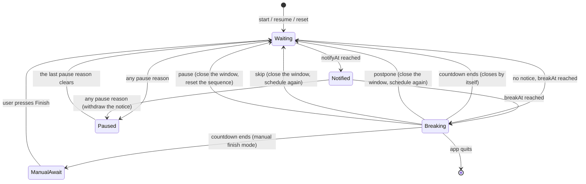

# Fermata (停琴) — functional specification

- Version: v1
- Status: **Normative — v1 as built**
- Behavior baseline: Stretchly **1.22.1** (commit `6278f00`, 2026-11-23)
- Platforms: macOS 13+, Windows 11 and Linux (shipping since v1.1.0). Development machine: macOS 27.2.1
- Document nature: normative. Implementation, tests and acceptance follow this document; where it conflicts with an older description of this behavior, this document wins.
- Priority: **P0** = required for v1; **P1** = the first round after v1
- Related documents: [product](product.md), [architecture](architecture.md), [design system](design-system.md), [development](development.md)

> This document describes only behavior the user can see, trigger or anticipate; it does not
> describe the Go code structure. For the implementation see
> [architecture](architecture.md); for interface and visual design see
> [design system](design-system.md).

---

## 0. Sources and boundaries

The behavior comes from these Stretchly files (behavior only is compared; no code is reused; Stretchly is BSD-2-Clause):

| Topic | Stretchly source file |
|---|---|
| Scheduling and state machine | `app/breaksPlanner.js`, `app/utils/scheduler.js` |
| Default settings | `app/utils/defaultSettings.js` |
| Postpone/skip decisions | `app/utils/utils.js` (`canPostpone`, `canSkip`) |
| Tray copy | `app/utils/statusMessages.js` |
| Tray menu and windows | `app/main.js` |
| Pause menu | `app/utils/pauseMenu.js`, `app/utils/untilMorning.js` |
| Idle detection | `app/utils/naturalBreaksManager.js` |
| Do Not Disturb detection | `app/utils/dndManager.js` |
| App exclusions | `app/utils/appExclusionsManager.js` |
| Command line | `app/utils/commands.js` |
| Break window | `app/miniBreak-renderer.js`, `app/longBreak-renderer.js`, `app/css/break.css` |
| Multiple displays | `app/utils/displayManager.js` |
| Preferences window | `app/preferences.html`, `app/preferences-renderer.js` |
| First launch | `app/welcome.html`, `app/welcome-renderer.js` |
| Copy | `app/locales/en.json` |

This document uses **must / should / may** to mark the strength of each constraint. Every time value is in milliseconds; the interface shows it according to the locale.

### 0.1 One-page overview

- **Default rhythm**: a 5-minute mini break every 25 minutes; after every 4 mini breaks, a 15-minute long break (Pomodoro). The interval counts from the **end of the previous break**.
- **Notifications**: 10 seconds ahead for a mini break, 30 seconds ahead for a long break; can be turned off in settings.
- **Break window**: closes by itself when the countdown reaches zero; with "wait for me to finish" on, it waits for the user to press Finish.
- **Postpone**: available only in the first 30%, once by default; 2 minutes for a mini break, 5 minutes for a long break.
- **Skip**: available after 30%, or when postpone is off; strict mode cannot skip and cannot postpone.
- **Pause**: manual (30m/1h/2h/5h/morning/indefinitely), Focus, idle, lock screen, app exclusion (P1); after resuming, a whole interval starts again.
- **Sleep**: a missed break is not shown late; after waking the schedule restarts from the next break.
- **Multiple displays**: one break pane per display; content can be shown on chosen displays only, the rest stay flat color.
- **Entry points**: the menu bar mark plus its menu; `Cmd+X` is the only shortcut inside a break window.
- **Data**: `~/Library/Application Support/Fermata/config.json`; the CLI and the single instance share one process.

---

## 1. Terminology and model

| Term | Meaning |
|---|---|
| **break** | A stretch of time in which no work is done and the user leaves the screen. Either a **mini break** or a **long break** |
| **sequence** | The stream of break numbers produced from a start/resume/reset, advancing mini, mini, long, mini, mini, long… |
| **cycle** | One "end of a break → start of the next break" interval; the cycle length is `mini.intervalMs` |
| **notified** | The `notifyLeadMs` notice window before a break starts |
| **postpone** | Pushing the current break later; the break type and the sequence position do not change |
| **skip** | Ending the current break early and counting it as having happened |
| **pause** | Stopping the schedule until the pause reasons clear; unlike skip, it does not consume a sequence position |
| **strict** | A break type that cannot be skipped, closed, or paused from the menu/CLI |
| **manual finish** | After the countdown reaches zero the window does not close; it waits for the user to press Finish |
| **danger** | P1. A soft 0–10 counter that affects only visuals and statistics, never the schedule |

Core invariants:

1. At most one break runs at any moment.
2. The next break is scheduled only after the current break has ended / been postponed / been skipped / been paused; schedules do not overlap.
3. Scheduling computes deadlines on a monotonic clock; only "pause until morning" uses wall-clock time.
4. A settings change does not alter the duration of a running break; it takes effect from the next cycle.
5. The break window can close only because of: the countdown ending, postpone, skip, manual finish, pause, reset, app quit, or the end of the system session.

---

## 2. Defaults

| Key | Default | Meaning |
|---|---|---|
| `schedule.mini.enabled` | `true` | Mini breaks on |
| `schedule.mini.durationMs` | `300000` | A mini break is 5 minutes |
| `schedule.mini.intervalMs` | `1500000` | One every 25 minutes |
| `schedule.mini.notify` | `true` | Notice before the break |
| `schedule.mini.notifyLeadMs` | `10000` | 10 seconds ahead |
| `schedule.mini.postpone.enabled` | `true` | Postponing allowed |
| `schedule.mini.postpone.timeMs` | `120000` | Postpone by 2 minutes |
| `schedule.mini.postpone.limit` | `1` | At most 1 per cycle |
| `schedule.mini.postpone.percent` | `30` | Only the first 30% can postpone |
| `schedule.mini.strict` | `false` | Strict mode |
| `schedule.mini.manualFinish` | `false` | Manual finish |
| `schedule.long.enabled` | `true` | Long breaks on |
| `schedule.long.durationMs` | `900000` | A long break is 15 minutes |
| `schedule.long.everyNBreaks` | `4` | One long break after every 4 mini breaks (that is, every 5th break); only in effect while mini breaks are on |
| `schedule.long.intervalMs` | `6000000` | The interval when only long breaks are on (100 minutes) |
| `schedule.long.notify` | `true` | Notice before the break |
| `schedule.long.notifyLeadMs` | `30000` | 30 seconds ahead |
| `schedule.long.postpone.enabled` | `true` | Postponing allowed |
| `schedule.long.postpone.timeMs` | `300000` | Postpone by 5 minutes |
| `schedule.long.postpone.limit` | `1` | At most 1 per cycle |
| `schedule.long.postpone.percent` | `30` | Only the first 30% can postpone |
| `schedule.long.strict` | `false` | Strict mode |
| `schedule.long.manualFinish` | `false` | Manual finish |
| `schedule.pauseDurationsMs` | `[1800000,3600000,7200000,18000000]` | 30 min / 1 h / 2 h / 5 h |
| `schedule.morningHour` | `6` | 6:00 for "pause until morning" |
| `schedule.skipPeriodsEnabled` | `false` | Master switch for skip periods |
| `schedule.skipPeriods` | `[]` | At most 4 local time windows in which breaks are skipped |
| `presence.idle.enabled` | `true` | Pause while idle |
| `presence.idle.resetAfterMs` | `300000` | 5 minutes idle counts as away |
| `presence.idle.checkIntervalMs` | `2000` | Check every 2 seconds |
| `presence.dnd.enabled` | `true` | Pause while Focus / Do Not Disturb is on |
| `presence.dnd.checkIntervalMs` | `2000` | Check every 2 seconds |
| `presence.pauseOnLock` | `true` | Pause on lock/sleep |
| `breakWindow.allScreens` | `true` | A mask on every display |
| `breakWindow.screen` | `"primary"` | The target display when a single display is used |
| `breakWindow.contentScreen` | `"all"` | Which displays show the content |
| `breakWindow.fillScreen` | `false` | Fill the display, the menu bar and the Dock included (otherwise 85%) |
| `breakWindow.widthRatio` | `0.85` | Window width as a share of the display |
| `breakWindow.heightRatio` | `0.85` | Window height as a share of the display |
| `breakWindow.field` | `"pine"` | The break window's field preset |
| `breakWindow.showIdeas` | `true` | Show the break suggestion |
| `breakWindow.showCurrentTime` | `false` | Show the current time in the bottom right |
| `sound.muted` | `false` | Mute all sounds (notification sounds included) |
| `sound.volume` | `1.0` | Volume |
| `sound.miniStart` / `sound.longStart` | `"silence"` | Start sound |
| `sound.miniEnd` / `sound.longEnd` | `"crystal-glass"` | End sound |
| `shortcuts.endBreak` | `"CmdOrCtrl+X"` | Finish/postpone/skip shortcut inside the break window |
| `general.openAtLogin` | `false` | Start at login |
| `general.language` | `"system"` | Follow the system, or `en` / `zh-Hans` |
| `general.menuBarStyle` | `"mark"` | `mark` / `time` / `progress` |
| `presence.fullscreen` | `true` | Hold a due break while an app is fullscreen |
| `presence.waitWhileTyping` | `false` | Hold a due break while typing (opt-in) |
| `presence.appExclusions` | `[]` | Pause or allow breaks while an app runs |

Long-break sequence: `n` is the number of the next break (starting at 1); when both mini and long breaks are on, `n % (everyNBreaks + 1) == 0` is a long break. With the default `everyNBreaks = 4` the sequence is: mini, mini, mini, mini, long, mini…

---

## 3. Scheduling algorithm

### 3.1 Scheduling

Let:

- `n` = the number of the next break, 1 after a reset
- `L` = `schedule.long.everyNBreaks`
- `M` = `schedule.mini.intervalMs`
- `LI` = `schedule.long.intervalMs`
- `anchor` = the moment the previous break ended, or the moment of start/resume/reset
- `lead(kind)` = the `notifyLeadMs` of that break type (0 when its notice is off)

Rules:

1. **Type**
   - Both mini and long on: `kind = (n % (L+1) == 0) ? long : mini`
   - Only mini on: `kind = mini`
   - Only long on: `kind = long`
2. **Interval**
   - Mini breaks on: `gap = M` (whether this break is mini or long)
   - Mini breaks off (only long on): `gap = schedule.long.intervalMs` (default 100 minutes)
3. **Moments**
   - `breakAt = anchor + gap`
   - If `kind.notify` is true and `lead(kind) < gap`: `notifyAt = breakAt - lead(kind)`; otherwise no notification is sent and `notifyAt = breakAt`
   - If `lead(kind) >= gap` (an invalid configuration): `lead` converges to `gap / 2`, and the fact is logged
4. **Advancing**
   - Break ends normally: `anchor = endAt`, `n = n + 1`, schedule again with the new `n`
   - Postpone: `anchor = postponeAt`, `n` unchanged, schedule again by the postpone rules
   - Skip: `anchor = skipAt`, `n = n + 1`, schedule again with the new `n`
   - Pause: clear the schedule, `n = 0`; on resume `anchor = resumeAt`, `n = 1`
   - Reset: close the current break, `n = 0`, clear the postpone count; if paused, stay paused; otherwise `anchor = now`, `n = 1` and schedule
5. **Start**: on the first run, pressing Start in the welcome window sets `anchor = now`, `n = 1`; nothing is scheduled while the welcome window is open.

### 3.2 Timeline example (default settings)

Started at 09:00:00:

| Event | Moment | Note |
|---|---|---|
| Mini break 1 | 09:25:00 | Notice 10 seconds ahead, 09:24:50 |
| Ends | 09:30:00 | `n=2`; the next interval counts from this moment |
| Mini break 2 | 09:55:00 | Notice 09:54:50 |
| Ends | 10:00:00 | `n=3` |
| Mini break 3 | 10:25:00 | Notice 10:24:50 |
| Ends | 10:30:00 | `n=4` |
| Mini break 4 | 10:55:00 | Notice 10:54:50 |
| Ends | 11:00:00 | `n=5` |
| Long break 5 | 11:25:00 | Notice 11:24:30 (30 seconds ahead) |
| Ends | 11:40:00 | `n=6` |
| Mini break 6 | 12:05:00 | Notice 12:04:50 |

> Note: long and mini breaks use the same `M` interval; `L` only decides **which** break is long, it does not lengthen the interval.
> With only long breaks on, the interval is `schedule.long.intervalMs` (default 100 minutes).

### 3.3 Boundaries

- If the notice moment has already passed (for example the app just started and `anchor` is long ago), no notification is sent and scheduling begins with the next break.
- If the system slept across `breakAt` and `pauseOnLock` is off: **the break is not shown late**. On waking the break counts as missed, `n = n + 1`, and the schedule restarts from the wake (see §6.5).
- Settings change: if only the next break's duration/interval/notice switch changed, `notifyAt`/`breakAt` are recomputed; if `L` or an enabled state changed, the type is decided again from the current `n` and the schedule is recomputed. A running break is unaffected.
- If the current `n`'s type changes from long to mini (or the reverse) because of a settings change, a notice already scheduled is not interrupted; the next scheduling takes effect.

---

## 4. State machine

| State | Meaning | Has a deadline | Can postpone | Can skip | Can pause |
|---|---|---|---|---|---|
| `Waiting` | Waiting for the next break | Yes (`notifyAt`/`breakAt`) | — | — | Yes |
| `Notified` | Notice sent, waiting for the break to start | Yes (`breakAt`) | — | — | Yes |
| `Breaking` | A break is running | Yes (`endAt`) | When the conditions hold | When the conditions hold | Yes (not strict) |
| `ManualAwait` | The countdown reached zero, waiting for Finish | No | No | No | Yes (not strict) |
| `Paused` | Paused, nothing scheduled | Only for a timed manual pause | — | — | — |

State invariants:

- In `Breaking` there must be one break window group (one window per target display).
- In `Paused` no notice may remain; entering a pause calls `Notification.Close()` on the unread notice.
- `ManualAwait` appears only when the matching type's `manualFinish` is true.
- Only `Waiting` / `Notified` allow "skip to" a break.

---

## 5. Break rules

### 5.1 Starting

1. On reaching `breakAt`:
   - Cancel that notice notification (if it is still showing).
   - Record a **snapshot** of `startAt = now`, `duration`, `kind`, `strict` and the `postpone` settings; later settings changes do not affect this break.
   - Play the start sound (`miniStart`/`longStart`, default `silence`; not played while `sound.muted` is true).
   - Create/show the break window (see §7).
   - `n` increments when the break ends, not when it starts.
2. If the user enters a break directly through **Skip to**: close the running break first (if any), then set `n` for the target type and start after 100ms; with the `--wait` parameter the command waits first, then starts.
   - Skip to a mini break: if the current `n % (L+1) == 0` (the next break would be long), set `n = 1`; otherwise keep `n`. Start the mini break; `n` increments when it ends. Refused when the target type is off.
   - Skip to a long break: set `n = L + 1` (so the next number is a long break); start the long break; when it ends `n` increments to `L + 2` and the next break is a mini break again. Refused when the target type is off.
3. If creating the break window fails (for example every display was unplugged): log it, increment `n`, schedule again, and do not retry showing it.
4. Strict mode and manual finish are not mutually exclusive: a strict break with manual finish on enters `ManualAwait` when it runs out, and Finish is still the only action.

### 5.2 Countdown and progress

- The countdown is computed as `startAt + duration - now`, not accumulated per frame; while visible, frames are requested at 1Hz and the text is redrawn only when the second changes.
- The remaining time is shown as `m:ss` (for example `0:14`); at `>= 1 hour` it is `h:mm:ss`.
- The progress line shows the **share of elapsed time**: `elapsed / duration`, from 0 to 1.
- When the countdown reaches zero:
  - Normal mode: play the end sound, close the window, `n++`, schedule.
  - Manual finish mode: play the end sound, enter `ManualAwait`, do not close; show the overtime (counting from 0), hide postpone/skip, show Finish.
- Text and controls update only while the window is visible; frame requests stop once the window is hidden.

### 5.3 Postpone

Conditions for postpone to be available (all must hold):

1. `postpone.enabled == true`
2. `postpone.limit > 0` and `postponeUsed < postpone.limit`
3. This break has not entered `ManualAwait` yet
4. `elapsed <= duration × postpone.percent / 100` (the first 30% by default)

Rules:

- When the conditions hold, the break window shows **only** Postpone as its exit; Skip is not shown.
- On click: close the window (no end sound), `postponeUsed++`, `anchor = now`, and schedule again as follows:
  - If `notify` is true and `postpone.timeMs > lead(kind)`: `notifyAt = now + postpone.timeMs - lead(kind)`, `breakAt = now + postpone.timeMs`
  - Otherwise: `breakAt = now + postpone.timeMs`, and no notification is sent
- The break type and `n` stay unchanged; a postponed break is still the same break.
- The postpone count is cleared when that break ends; pause/reset also clear it; postpone itself does not clear it, otherwise the same break could be postponed without limit.
- Strict mode: **postponing is not allowed** (the v1 decision, see §15 D2).
- Manual finish mode: postponing is allowed, but only before the countdown reaches zero.

### 5.4 Skip

Conditions for skip to be available:

1. Not in strict mode
2. The "postpone available" condition does not hold (that is, postpone is used up, or past 30%, or postpone is off)
3. Not in `ManualAwait`

Rules:

- When the conditions hold, the break window shows **only** Skip as its exit.
- On click: close the window (no end sound), `n++`, `anchor = now`, and schedule the next break.
- A skip counts as that break having happened, the postpone count is cleared, and the P1 health rules are in §5.8.
- In strict mode Skip is never shown and the window cannot be closed (see §5.5).
- Once the countdown reaches zero skipping is no longer allowed (normal mode ends by itself; manual mode enters `ManualAwait`).

### 5.5 Strict mode

When it is on for a break type, this break:

1. Cannot be skipped; `canSkip` is always false.
2. Cannot be postponed; `canPostpone` is always false (overriding the postpone settings).
3. Cannot have its window closed: there is no close button; the window's close request is refused (`OnClose` prevent).
4. Cannot quit the app: the menu's Quit is hidden/disabled; `OnBeforeQuit` blocks quitting and shows a hint; the end of the system session (log out / shut down) cannot be prevented.
5. The tray menu keeps only the status line (and, in P1, the update item) and hides Skip to, Pause, Reset, Settings and Quit; the menu has no About. When `general.showTrayMenuInStrictMode` is true, Settings comes back; Quit is hidden regardless and `OnBeforeQuit` keeps blocking quitting.
6. The CLI's `pause`, `toggle`, `skip`, `reset`, `mini` and `long` are refused during a strict break (exit code 1); `finish` is available only in the manual finish stage.
7. Lock screen/sleep can still close a strict break (system events win); that does not count as a user skip.
8. Pause reasons (Focus, idle) do not interrupt a running strict break; after the break ends the new reasons decide whether to pause.
9. Changing settings during a strict break: changes are allowed, but "turning strict mode off" does not take effect until the current break ends.

### 5.6 Manual finish

When it is on, at the moment the countdown reaches zero:

1. Play the end sound (unless muted).
2. Do not close the window; enter `ManualAwait`.
3. The progress line empties; the countdown text becomes the overtime (`+0:07`) and keeps updating every second.
4. Hide Postpone / Skip and show Finish; the global shortcut `Cmd+X` equals Finish.
5. Tray status: "Break over — waiting for you".
6. The user presses Finish: close the window, `n++`, schedule the next break; the health counter treats it as a completion (long break -2, mini break -1).
7. If the user never presses it: the window stays until pause/reset/quit/a system event.
8. If a pause/reset happens in `ManualAwait`: it counts as a skip (health +1/+2) and the window closes.

### 5.7 Ending and sound

- The end sound defaults to `crystal-glass`; while `sound.muted` is true everything is silent, notification sounds included.
- The end sound plays once, when the countdown reaches zero: in normal mode before the window closes, in manual mode on entering `ManualAwait`; Finish does not play it again. The volume is `sound.volume`.
- The start sound defaults to `silence` and can be set in P1.
- A missing audio file or a decode failure: log it, do not block the flow.

### 5.8 Health mode (P1)

Only while `health.mode == true`:

- `danger` starts at 0 and ranges 0–10; it resets to 0 when the app restarts and on a reset.
- Postpone: +1; skip: +1 for a mini break, +2 for a long break; a pause interrupting a break: +1/+2; manual finish completed: -1/-2; normal completion: -1/-2.
- While `danger > 2` a vermilion inner shadow appears on the break window and grows stronger with `danger`; it does not change the schedule and shows no extra prompt.
- Turning health mode off in Settings sets `danger = 0`.

---

## 6. Pause and resume

### 6.1 Pause reasons

A pause is a **reason set**, not a single boolean. As long as the set is not empty, nothing is scheduled.

| Reason | Trigger | Clears | Resumes automatically | Tray display |
|---|---|---|---|---|
| `manual` | Menu / CLI / the Pause breaks submenu (P1: optional global shortcut) | The user's Resume, or the timer running out | Yes, when the timer runs out | "Paused — resuming in about 12 minutes" or "Paused — indefinitely" |
| `dnd` | System Focus / Do Not Disturb on | Focus turned off | Yes | "Paused — Focus is on" |
| `skipPeriod` | Local clock time falls inside an enabled skip period | The period ends, or the master switch is turned off | Yes | "Breaks skipped" |
| `idle` | Idle > `resetAfterMs` | The user comes back (idle < 20 seconds) | Yes | "Paused — you were away" |
| `lock` | Screen locked or system sleep | Unlock or wake | Yes | "Paused — the screen is locked" |
| `exclusion` | P1 app-exclusion rule matched | The rule no longer matches | Yes | "Paused — app exclusion rule" |

Priority (for display only, not for the pause logic): `manual > skipPeriod > dnd > idle > exclusion > lock`.
As long as any reason remains the pause holds; it resumes when the last reason clears.

### 6.2 Manual pause

- The Pause breaks submenu: 30 minutes, 1 hour, 2 hours, 5 hours, until morning, indefinitely.
- The durations come from `schedule.pauseDurationsMs`; "until morning" = the next `morningHour:00` (tomorrow if it has already passed).
- If a break is running when pausing: close the window, count it as a skip (health rules), and clear `n`.
- If the app is in the notice stage when pausing: close the notice notification.
- Resume:
  - The user presses Resume / CLI `resume`: remove the `manual` reason; if other reasons remain, stay paused and send no notification; otherwise schedule at once with `n = 1`, `anchor = now`, and send the system notification "Fermata is resuming."
  - The timer runs out: remove the `manual` reason; if other reasons remain, stay paused; otherwise resume automatically and send a "resuming" notification.
  - If Focus is still on when the timer runs out: remove the `manual` reason, but stay paused because `dnd` remains; once Focus is turned off it resumes by its own rule.
- A pause is not kept across an app restart (Stretchly does not keep it either).

### 6.3 Do Not Disturb / Focus

- The poll interval defaults to 2 seconds; it polls only while `presence.dnd.enabled` is true.
- Read order: try `~/Library/DoNotDisturb/DB/Assertions.json` first (usable when no extra authorization is needed); on macOS 26 and earlier also try `defaults -currentHost read com.apple.notificationcenterui doNotDisturb`.
- **No extra permission is requested**: on macOS 13+ that file is protected, and without Full Disk Access it is treated as unavailable — the setting is not shown, nothing is monitored and no authorization is requested; after the user grants it, a restart or a settings change enables it.
- While Focus is on:
  - `Waiting`/`Notified`: clear the schedule, withdraw the notice, `n = 0`, add the `dnd` reason.
  - `Breaking`: do not interrupt the current break; only add the reason. If the reason is still there when the break ends, schedule nothing, `n = 0`, and enter `Paused`.
  - `ManualAwait`: do not interrupt; the user can still press Finish, and afterwards the reason decides whether to pause.
- While Focus is off:
  - If other reasons remain: stay paused.
  - Otherwise: schedule again from `now`, `n = 1`; no "resuming" notification is sent (to avoid interrupting).
- A Focus detection failure does not prevent the app from starting; the reason is logged once.

### 6.4 Skip periods

- Configuration: `schedule.skipPeriodsEnabled` (bool, default `false`) is the master switch; `schedule.skipPeriods` holds at most 4 entries `{enabled, start, end, days}`. `start`/`end` are local 24-hour `"HH:MM"` values; `days` uses 1 = Mon … 7 = Sun, with an empty list selecting every day. Validation drops entries with invalid or equal times and entries past the limit, and filters out invalid weekdays; `version` stays 2.
- Matching: an entry describes a local window from `start` (inclusive) to `end` (exclusive) on its selected days. Each entry carries its own `enabled` flag; the Settings status counts enabled entries only. An end earlier than the start belongs to the following day, and the period belongs to its start day: `22:00–06:00` on Friday covers Friday 22:00 through Saturday 06:00. Boundaries are built from the local calendar with `time.Date` / `AddDate`, so week, month and year rollovers keep their weekday.
- Master switch: off → no `skipPeriod` reason and no extra wake-up; saved entries stay in the file and are shown disabled in Settings. On → the saved periods take effect; turning the master switch off inside a period removes the reason.
- Pause reasons: entering a period adds `skipPeriod`, like `dnd`, `idle` and `exclusion`. In `Waiting`/`Notified` the schedule is cleared, the notice withdrawn and `n = 0`; a running break is not interrupted, including a strict one. If the period is still active when that break ends, no next break is scheduled until it exits. Other reasons remain in the set until their own trigger clears.
- Anchor reset: leaving a period removes the reason; with no reason left, break 1 is scheduled from the exit time (`anchor = exit`, `n = 1`). No resume notification is sent. The skip does not consume a sequence position.
- Wake-up: the planner arms the earlier of a period boundary and the break deadline, so entry and exit take effect at the exact minute. No extra wake-up is armed when the master switch is off or an indefinite manual pause is in effect.
- Tray: while paused by a period the status line reads `Breaks skipped`; the paused icon shape applies.

### 6.5 Lock screen, sleep and wake

- While `presence.pauseOnLock` is true (the default):
  - Lock/sleep: add the `lock` reason; if a break is running, close the window (counted as a skip) and clear `n`; if in the notice stage, withdraw the notice.
  - Unlock/wake: remove the `lock` reason; if no other reason remains, schedule again from `now`, `n = 1`, and send no notification.
  - Sleep spanning the next `breakAt`: **the break is not shown late**; after waking the new schedule applies and `n` is not incremented again (it was already cleared when pausing).
- While `pauseOnLock` is false:
  - Do not pause; after waking, check whether `breakAt` has passed:
    - Passed: do not show it late; `n = n + 1`; schedule again from `now`.
    - Not passed: keep `breakAt` and continue with the remaining time (the deadline uses the monotonic clock; if system sleep delayed the timer, recompute from the actual `now`).
- `pauseOnLock` false and sleeping during a break: after waking, if `now >= endAt` treat it as the countdown ending (close, `n++`, schedule); if it has not ended but the system time jumped, continue with the remaining time.
- If the system clock is changed by hand: monotonic scheduling is unaffected; "until morning" uses wall-clock time and is recomputed after the change.

### 6.6 Idle (natural breaks)

- It polls only while `presence.idle.enabled` is true; the interval is 2 seconds.
- Thresholds:
  - Idle ≥ 20 seconds: counts as "away".
  - Idle ≥ `resetAfterMs` (5 minutes by default): add the `idle` reason. In `Waiting`/`Notified`: clear the schedule, withdraw the notice, `n = 0`; in `Breaking`/`ManualAwait`: **do not interrupt** (the break continues), and if the reason is still there when it ends nothing is scheduled, `n = 0`.
- The user comes back (idle < 20 seconds) after having been away longer than `resetAfterMs`:
  - Remove the `idle` reason; if no other reason remains, schedule again from `now`, `n = 1`, and send no notification.
- Coming back before 5 minutes of idle: it does not count as a pause; if `breakAt` was crossed while away, §6.5's "not shown late" applies: `n++`, and schedule again from the moment of return.
- During an idle pause the tray menu does not offer Resume (the user coming back resumes it); the status line shows the reason.
- When app exclusions (P1) and idle hit at the same time, they are handled as one reason set.

### 6.7 App exclusions (P1)

- Rules come from `presence.appExclusions`: `{name, commands: [string], rule: "pause" | "resume", active: true}`.
- Every 2 seconds the running processes are matched by process name / command-line substring.
- `rule = pause`: while the rule matches, add the `exclusion` reason; when it stops matching, remove it and resume scheduling.
- `rule = resume`: breaks are allowed only while the rule matches; while it does not match, add the `exclusion` reason.
- Only one `active` rule is in effect at a time; with several, the first wins.
- While a break is running and a `rule = pause` rule matches: close the current break (counted as a skip) and add the reason.
- If process enumeration fails: treat it as not matching and log it once.

### 6.8 Hold when due (P1)

- Trigger: the notice moment or the start moment of a break has arrived, and either
  - `presence.fullscreen` is true and a fullscreen app is in front (both the notice and the start are held, so the notice does not interrupt), or
  - `presence.waitWhileTyping` is true and the user is still typing when the start moment arrives (idle < 0.5 seconds), waiting silently for at most 30 seconds without showing "held".
- While held: no break window and no notice notification; the planner stays "waiting". A fullscreen hold says `Break held — fullscreen app` in the tray; a typing hold stays silent and keeps the ordinary countdown. Menu commands work as usual.
- Release: once the condition disappears the whole break starts at once with `Show` (a new break's full duration); it is not dropped as late and not shown as missed.
- Upper bounds: at most 1 hour for fullscreen and at most 30 seconds for typing; once a bound is reached the break starts/appears as usual.
- A user pause/resume/reset/skip cancels the hold; a settings change does not cancel it and leaves the next round to decide.
- The fullscreen check reads only window bounds, level and owning PID and **does not request screen-recording permission**; a failed read counts as no fullscreen and is logged once.

### 6.9 Common rules during a pause

- During a pause nothing is scheduled, no notice notification is sent and no start sound plays; `manual`/`lock` close a break window that is showing, `dnd`/`idle`/`exclusion`/`skipPeriod` do not (they take effect after the break ends).
- During a pause the tray icon shows the "paused" shape.
- When the pause reasons clear, a whole new interval starts from `now`; the remaining time is not restored.
- A pause does not clear the health counter (P1).
- During a strict break only `lock` can interrupt; `dnd`/`idle`/`exclusion`/`skipPeriod` do not.

### 6.10 Notification and status popover (P1)

- At the notice moment only a system notification is sent (`Mini break in {n} seconds` / `Long break in {n} seconds`); the self-dismissing floating panel is gone. Clicking the notification opens the status popover.
- In `Notified` the popover offers `Start now`, `Push 5 minutes` and `Pause 30 minutes`; `Start now` starts the whole break at once, `Push 5 minutes` delays it without clearing the sequence.
- Ignoring the notification needs no action: the break still starts on time; clicking the notification only adds one more way in.

### 6.11 Status popover (P1)

- Left-click on the tray icon: open/close the popover; right-click or Control-click: the native menu. The popover takes the keyboard while it shows, as the system's own menu bar popovers do, and dismisses as they do. The popover also has `⋯` (menu) and `×` (close) at its top right. Linux's tray reports no clicks, so the menu is its icon's only target there; `Skip to` and a click on a notice open the same popover, in the middle of the primary display's work area.
- The icon carries a menu only while the menu shows. A menu left on it would turn every click, a left click included, into the menu; so changing settings or the language never puts one there.
- Content: two status lines (the same as the tray), the remaining time in large type, a hairline progress bar (no ring); the actions change with the state: while waiting `Take a break now` and `Pause 30 minutes`; while notified `Start now` / `Push 5 minutes` / `Pause 30 minutes`; while paused `Resume breaks`; `Settings…` is always there.
- It closes on a second left-click, on a click outside it, on `Esc`, when another app comes to the front, on `×`, when an action runs, when a break starts, or when a right-click opens the menu; once the waiting/paused state ends the buttons change with it.

### 6.12 Restart continuity (P1)

- While running, the next break is written to `schedule.json` in the user data directory (atomic write); the file is deleted when a break starts, when the app pauses, or when it quits into a non-waiting state.
- At launch, if the state file is at most 10 minutes old, `breakAt` is still in the future and the format is valid, then `N`, `breakAt` and `notifyAt` are restored (a notice that has already passed is ignored); otherwise the app schedules as a fresh launch.
- Only the "waiting" state is restored: a break in progress, manual finish and paused are not restored; the first-run/welcome flow is not restored either.
- Hint: if the user restarts repeatedly within 10 minutes the countdown continues; after 10 minutes the file is void.

---

## 7. Break window

### 7.1 Window geometry

- One window per target display; no title bar, no zoom/minimize/close button, never in the Dock or the app switcher.
- The default size is the display bounds' `widthRatio × heightRatio` (0.85 × 0.85), centered inside the display bounds.
- The window's corner radius is 20 pt; when `fillScreen` is true it fills the display bounds and the radius becomes 0.
- A window the size of the display covers the menu bar and the Dock as well; a smaller one stays below them. No Space is taken and no kiosk mode is entered.
- Always on top, above every Space / fullscreen app; showing it does not activate the app and does not take keyboard focus.
- The window swallows mouse clicks that land on it (so the desktop is not clicked by accident), but only the action button responds.
- The user cannot drag or resize the window.
- Showing fades in over 180 ms while the content rises over 220 ms; closing is immediate. Under Reduce Motion both appear at once.

### 7.2 Multiple displays

| Setting | Behavior |
|---|---|
| `allScreens = true`, `contentScreen = all` | One window per display, every display shows the content |
| `allScreens = true`, `contentScreen = primary/cursor/N` | One window per display; only the target display shows the content, the others show flat field color only (no text, no progress, no button) |
| `allScreens = false` | Create one window and show the content only on the display named by `screen` (primary/cursor/N) |

- Displays added/removed or resolution changed during a break: rebuild the window group, keeping `startAt`, `duration`, the elapsed time and the action state; do not restart the countdown.
- A target display index that no longer exists: fall back to the display with the pointer and log it.
- A primary display change (the user drags the menu bar): do not interrupt the current break; the next break uses the new primary.

### 7.3 Content

The content display, top to bottom:

0. **Mark**: the 48×48 fermata mark, 28 pt above the suggestion; arc 2.6, dot 2.9 (the optical sizes in [design system](design-system.md) §2.1).
1. **Top-left label**: `MINI BREAK` / `LONG BREAK`; `STRICT MINI BREAK` / `STRICT LONG BREAK` when strict. 11 pt, all caps, +0.14em tracking, paper at 55%.
2. **Top-right current time** (optional): `14:32`, following the locale's 12/24-hour clock; 11 pt, paper at 55%.
3. **Central break suggestion**:
   - Mini break: one suggestion sentence, at most 4 lines; 42/51 pt (38/46 when the window is narrower than 1280); for Chinese +2 pt with line height ×1.25; serif; centered.
   - Long break: a title (at most 2 lines, 50/57 pt, 46/53 on a narrow window) + body text (at most 3 lines, 26/36 pt, paper at 72%); for Chinese, title 52/65 (48/60 on a narrow window), body 28/35; 24 pt between title and body.
   - With `showIdeas = false` no suggestion is shown; only the mark, the progress and the countdown.
4. **Progress line**: 280 pt wide (360 pt for a long break), 1 pt high; the track is paper at 25%, the elapsed part paper at 85%; 40 pt below the suggestion.
5. **Countdown**: 16 pt below the progress line, `0:14`; 13 pt monospaced digits, paper at 65%, +0.04em tracking.
6. **Exit**: bottom center of the window, 64 pt from the bottom; at most one at a time:
   - Postpone available: `Postpone · ⌘X`; skip available: `Skip · ⌘X`; manual finish stage: `Finish · ⌘X`; strict and still counting down: none.
   - 15 pt; paper at 80%; hovering draws a paper underline over 120ms.
7. **Health mode** (P1): a vermilion inner shadow around the window while `danger > 2`; the layout does not change.

Rules:

- Text that is too long: the font size is not stepped down per content; only the whole step is switched by window width, then ellipsis truncation at the maximum line count; no scrolling, no window scaling.
- An empty suggestion: keep the vertical rhythm, show no empty line.
- Strict mode: no exit is shown while counting down; the top-left label becomes `STRICT MINI BREAK` / `STRICT LONG BREAK`; no lock icon is loaded (to avoid that semantic's system warning). With "wait for me to finish" on, Finish is still shown after zero.
- Manual finish stage: the progress line empties; the countdown becomes `+0:07` (overtime) and updates every second; only Finish is shown.
- The break window shows no application name, no wordmark and no settings entry.

### 7.4 Background and transparency (P1)

- `breakWindow.backgroundImage = true` and the user data directory's `backgrounds/` holds images (png/jpg/jpeg/webp/gif): one image is chosen at random without repeating, with a 60% black scrim; an image that fails to decode is skipped and logged.
- `transparent = true`: the field's alpha = `opacity` (0.0–1.0, default 0.9); it affects the field only, not the text.
- Neither appears in the v1 Settings UI; both are accepted from the configuration file only.

### 7.5 Shortcuts

- `shortcuts.endBreak` (default `CmdOrCtrl+X`) is registered only while the break window is showing; it is unregistered when the break ends, on a pause and on quit.
- The action is decided by the current state and availability:
  - postpone available → postpone
  - otherwise skip available → skip
  - `ManualAwait` → finish (finishing is allowed in strict mode too)
  - strict mode and not yet in `ManualAwait` → no action (no error, no hint)
- A failed registration (taken by another app): log it; the break window still works with the mouse; the Settings page shows no hint (P1 may add one).
- The window itself does not take keyboard focus; nothing depends on Tab/Enter.

---

## 8. Tray

### 8.1 Status copy

The status is generated from the current phase + reason set + `timeToNextBreak`; times are rounded according to the locale:

| State | Copy template (en) |
|---|---|
| Waiting (mini) | `Next mini break in about {n} minutes` |
| Waiting (long) | `Next long break in about {n} minutes` |
| Waiting (with a long break ahead) | Second line `Long break after {n} more mini breaks` |
| Notified | `Mini break in {n} seconds` / `Long break in {n} seconds` |
| Breaking | `Mini break — {m:ss} left` / `Long break — {m:ss} left` |
| Manual finish | `Break over — waiting for you` |
| Manual pause (timed) | `Paused — resuming in about {n} minutes` |
| Manual pause (indefinite) | `Paused — indefinitely` |
| Focus | `Paused — Focus is on` |
| Skip period | `Breaks skipped` |
| Idle | `Paused — you were away` |
| Lock screen | `Paused — the screen is locked` |
| App exclusion (P1) | `Paused — app exclusion rule` |
| Strict break | `Strict mini break — {m:ss} left` / `Strict long break — {m:ss} left` |

Rules:

- Remaining time below 60 seconds uses "seconds"; at 0 it shows "any moment now" (`Mini break any moment now` / `Long break any moment now`).
- The tray tooltip's first line is always `Fermata — A held note in the workday`; after a blank line the status copy follows.
- During a strict break no menu item other than the status line is shown; when `general.showTrayMenuInStrictMode` is true only Settings comes back.

### 8.2 Menu matrix

| State | Status line | Skip to | Pause | Resume | Reset | Settings | Quit |
|---|---|---|---|---|---|---|---|
| Waiting / Notified | yes | yes | yes | — | yes | yes | yes |
| Breaking (not strict) | yes | yes | yes | — | yes | yes | yes |
| Manual finish (not strict) | yes | yes | yes | — | yes | yes | yes |
| Manual pause | yes | — | — | yes | — | yes | yes |
| Focus / skip period / idle / locked / exclusion | yes | — | — | — | — | yes | yes |
| Strict break | yes | — | — | — | — | — | — |

- The Skip to submenu: `Mini break` / `Long break`, only for the types that are on; an empty shortcut is shown as an ordinary item.
- The Pause submenu: 30 minutes, 1 hour, 2 hours, 5 hours, until morning, indefinitely.
- Menu items use localized short labels; the status line is disabled; there is no About (the About page lives in the Settings sidebar).
- While the menu is open only the status line is updated (`SetLabel`); the whole menu is not rebuilt, so it does not close under the user.
- A manual pause offers only Resume; Reset has no visible effect while paused, so it is not shown (the CLI can still `reset`, which clears the sequence and does not lift the pause).
- Focus/skip period/idle/locked/exclusion offer no Resume (the reason resumes it by itself) and no Reset either.
- During a strict break Quit is hidden; the end of the system session can still quit.

### 8.3 Menu bar icon

| Style | Content | Width |
|---|---|---|
| `mark` (default) | the fermata mark (arc + dot) | 18 pt |
| `time` | the mark + the title `9m`, monospaced digits | 18 pt + text |
| `progress` | ring progress + a center dot | 18 pt |

- Paused/Focus/idle/locked: a two-bar "pause" icon; a strict break still uses the mark.
- The title is at most `99m`; beyond that it shows `99m` and the tooltip gives the exact value.
- The icon is a template image, tinted light or dark by the system; there is no color icon.
- Update cadence: the title/icon once a minute; state changes (break, pause, strict, resume) update at once; the progress style updates at the coarser of 1% or one minute, to avoid constant redraws.
- With no menu bar title the tooltip is still complete.

### 8.4 App icon

- Not shown in the Dock (`LSUIElement` + accessory).
- The app icon and the DMG icon use the design system's "sand field + ink fermata + vermilion dot", the same geometry as the interface and the menu bar; the menu bar icon is generated separately as an 18 pt optically bolded template.
- Name and mark share one origin: the English *Fermata* is the musical hold, and the Chinese name is its reading. The icon adds no strings or staff — at 16–32 px they would break the mark.

---

## 9. Notifications and sound

### 9.1 Notice before a break

- Trigger: `notifyAt`; only while the matching type's `notify = true`.
- Title: `Fermata` (macOS notifications already show the app name, so the title may be empty; the implementation uses the app name).
- Body: `Mini break in 10 seconds.` / `Long break in 30 seconds.` (the seconds come from `notifyLeadMs`).
- Sound: follows the system notification sound; muted while `sound.muted` is true (`Silent: true`).
- Click: no action (does not open a window, does not change the schedule); the notification disappears after the click.
- When a break starts or the app pauses: close the notice notification if it has not disappeared yet.
- Notification permission denied: it cannot be detected (MyGo has no authorization query API); it does not block the app; the Settings page carries a "Notifications" note (P1).

### 9.2 Resume notification

- Sent only for "a timed manual pause ran out" and "the user resumed by hand": `Fermata is resuming.`
- Resumes caused by Focus, idle, lock screen or app exclusions send no notification.

### 9.3 Sounds

| Event | Default | Choices |
|---|---|---|
| Mini break starts | `silence` | `silence`, `crystal-glass`, `wind-chime`, `tic-toc`, `reverie` |
| Mini break ends | `crystal-glass` | the same |
| Long break starts | `silence` | the same |
| Long break ends | `crystal-glass` | the same |

- Volume `0.0–1.0`; while `sound.muted` is true nothing plays.
- The built-in sounds are WAVs inside the app; P1 allows a user WAV of the same name in the `audio/` directory to override one.
- A playback failure does not block the flow; it is logged once.

---

## 10. Settings

### 10.1 File

- Path: `~/Library/Application Support/Fermata/config.json` (`App.Path(PathUserData)` + `config.json`).
- JSON, UTF-8, indented with 2 spaces; writes replace the file atomically using "temporary file in the same directory + fsync + rename".
- Unknown fields are **kept** (forward compatibility); writing merges the kept fields.
- Permissions: `0644`; it holds no sensitive information.
- Corrupt: the original file is renamed to `config.corrupt.<timestamp>.json`, the defaults are loaded and the fact is logged; the Settings page shows a one-time notice.
- Write failure: the in-memory settings keep applying and the Settings page shows a banner; the write is retried on the next change.
- v1 does not watch the file for external changes; after editing the configuration by hand the app must be restarted (P1 may add `WatchFiles`).

### 10.2 Fields, validation and UI exposure

| Field | Type | Default | Validation | v1 UI |
|---|---|---|---|---|
| `version` | int | `2` | fixed | — |
| `general.openAtLogin` | bool | `false` | — | General |
| `general.language` | string | `"system"` | `system`/`en`/`zh-Hans` | General |
| `general.menuBarStyle` | string | `"mark"` | `mark`/`time`/`progress` | General |
| `shortcuts.endBreak` | string | `"CmdOrCtrl+X"` | a valid accelerator | General (P1) |
| `schedule.mini.enabled` | bool | `true` | at least one type on | Schedule |
| `schedule.mini.durationMs` | int | `300000` | 10000–600000, step 10000 | Schedule |
| `schedule.mini.intervalMs` | int | `1500000` | 300000–3900000, step 300000 | Schedule |
| `schedule.mini.notify` | bool | `true` | — | Schedule |
| `schedule.mini.notifyLeadMs` | int | `10000` | 1000–60000; < interval | file (P1) |
| `schedule.mini.postpone.enabled` | bool | `true` | — | Schedule |
| `schedule.mini.postpone.timeMs` | int | `120000` | 60000–3600000 | file (P1) |
| `schedule.mini.postpone.limit` | int | `1` | 0–5 | file (P1) |
| `schedule.mini.postpone.percent` | int | `30` | 0–100 | file (P1) |
| `schedule.mini.strict` | bool | `false` | — | Schedule |
| `schedule.mini.manualFinish` | bool | `false` | — | Schedule |
| `schedule.long.enabled` | bool | `true` | at least one type on | Schedule |
| `schedule.long.durationMs` | int | `900000` | 60000–3600000, step 60000 | Schedule |
| `schedule.long.everyNBreaks` | int | `4` | 1–30 | Schedule |
| `schedule.long.intervalMs` | int | `6000000` | 600000–7200000, step 600000 | Schedule (only while mini breaks are off) |
| `schedule.long.notify` | bool | `true` | — | Schedule |
| `schedule.long.notifyLeadMs` | int | `30000` | 1000–60000; < interval | file (P1) |
| `schedule.long.postpone.*` | — | same as mini | same as mini | Schedule/file |
| `schedule.long.strict` | bool | `false` | — | Schedule |
| `schedule.long.manualFinish` | bool | `false` | — | Schedule |
| `schedule.pauseDurationsMs` | int[] | 30m/1h/2h/5h | each 60000–86400000, whole minutes | file (P1) |
| `schedule.morningHour` | int | `6` | 0–23 | file (P1) |
| `schedule.skipPeriodsEnabled` | bool | `false` | — | Schedule |
| `schedule.skipPeriods` | object[] | `[]` | at most 4; each `{enabled, start, end, days}` | Schedule |
| `presence.idle.enabled` | bool | `true` | — | General |
| `presence.idle.resetAfterMs` | int | `300000` | 60000–3600000 | General (5/10/15 minutes) |
| `presence.idle.checkIntervalMs` | int | `2000` | fixed 2000 | file |
| `presence.dnd.enabled` | bool | `true` | — | General (shown only when the system exposes it without extra permission) |
| `presence.dnd.checkIntervalMs` | int | `2000` | fixed 2000 | file |
| `presence.fullscreen` | bool | `true` | — | General (macOS only) |
| `presence.waitWhileTyping` | bool | `false` | — | General |
| `general.theme` | string | `"system"` | `system`/`light`/`dark` | Appearance |
| `presence.pauseOnLock` | bool | `true` | — | General |
| `general.showTrayMenuInStrictMode` | bool | `false` | — | file (P1) |
| `presence.appExclusions` | object[] | `[]` | — | General (App exclusions) |
| `breakWindow.allScreens` | bool | `true` | — | General |
| `breakWindow.screen` | string | `"primary"` | `primary`/`cursor`/`0..N` | General |
| `breakWindow.contentScreen` | string | `"all"` | `all`/`primary`/`cursor`/`0..N` | General |
| `breakWindow.fillScreen` | bool | `false` | — | General |
| `breakWindow.widthRatio` | float | `0.85` | 0.5–1.0 | file (P1) |
| `breakWindow.heightRatio` | float | `0.85` | 0.5–1.0 | file (P1) |
| `breakWindow.field` | string | `"pine"` | a preset or `custom` | Appearance |
| `breakWindow.customField` | string | `"#24413A"` | `#rrggbb` | Appearance |
| `breakWindow.showIdeas` | bool | `true` | — | file |
| `breakWindow.showCurrentTime` | bool | `false` | — | Appearance |
| `breakWindow.transparent` | bool | `false` | P1 | P1 |
| `breakWindow.opacity` | float | `0.9` | 0.3–1.0 | Appearance |
| `breakWindow.backgroundImage` | bool | `false` | P1 | P1 |
| `sound.muted` | bool | `false` | — | Appearance |
| `sound.volume` | float | `1.0` | 0–1 | Appearance |
| `sound.miniStart` / `longStart` | string | `"silence"` | a sound in the enum | Appearance |
| `sound.miniEnd` / `longEnd` | string | `"crystal-glass"` | a sound in the enum | Appearance |
| `health.mode` | bool | `false` | `danger=0` when off | Schedule |
| `isFirstRun` | bool | `true` | internal | — |

Validation rules:

- Any out-of-range value **converges** to the boundary and is logged; the app does not refuse to start.
- `mini.enabled` and `long.enabled` cannot both be false; when the configuration says false/false, `mini.enabled = true` is forced and the fact is logged.
- When `notifyLeadMs >= intervalMs` it converges to `intervalMs / 2`.
- `postpone.timeMs` may be greater than `intervalMs`; a postpone affects only the current cycle and produces no overlap.
- Invalid color: falls back to `#24413A`.
- Invalid sound name: falls back to `silence` (start) / `crystal-glass` (end).
- Invalid enum: falls back to the default.
- A skip period is dropped when `start`/`end` is not `HH:MM` or when they are equal; invalid weekdays are filtered out, valid weekdays are sorted and de-duplicated, and entries past the fourth are dropped. Adding the feature does not change `version` (still 2).
- `version` greater than the supported one: treated as an unknown field, no migration; only the known fields are read.

### 10.3 Restore defaults

- Entry: Settings → About → "Restore Defaults…".
- Uses the system's native confirmation dialog: title "Restore defaults?", body "All settings return to their initial values. This cannot be undone.", buttons "Cancel / Restore".
- After confirming: close a running break, clear the pause, reset the schedule, `n = 1`, reset the health counter to zero; `isFirstRun` stays `false`; the language returns to `system`.
- The entry is not offered during a strict break (Settings is unreachable).

### 10.4 Migration

- The current `version = 2`: on v1→v2, if the schedule is still the old default (20 seconds / 10 minutes / 5 minutes / every 3rd) it migrates to the Pomodoro one (5 minutes / 25 minutes / 15 minutes / every 4th) and turns `waitWhileTyping` off; a custom schedule is kept.
- Unknown fields are kept; a missing `version` counts as 1.
- A failed migration: back up the original file, load the defaults, log it.

---

## 11. First run

1. No configuration file → write the default configuration, `isFirstRun = true`.
2. Language default: if the system's preferred language is `zh-Hans`/`zh-CN` it is `zh-Hans`, if it is `en` it is `en`, otherwise `en`; the resolved result is also cached for display while `general.language = "system"`.
3. Show the welcome window (see [design system](design-system.md)):
   - On the left, a live miniature preview of the break window (default mini break, 5 minutes, the default suggestion).
   - On the right: the product name, a one-line explanation, a summary of the default rhythm, the language choice, the "Start at login" switch (off by default), the "Start" primary button and the "Open Settings" secondary button.
4. Pressing Start or closing the welcome window:
   - `isFirstRun = false`, write the configuration.
   - `anchor = now`, `n = 1`, scheduling begins.
   - If the user presses "Open Settings": open the Settings window and begin scheduling the same way; the welcome window closes.
5. While the welcome window is open nothing is scheduled, no notification is sent and no break window is created.
6. With an existing configuration and `isFirstRun = false`: no welcome window, scheduling immediately.
7. The first run does not turn "Start at login" on by itself and does not request notification permission (the system asks on the first notification).
8. CLI first run: if the app is started with a command (for example `fermata pause 30`), the first-run initialization is completed first (without showing the welcome window?) — the rule: the welcome window is still shown on the first run and the command runs after the start; `version`/`help` are the exceptions.

---

## 12. Command line and single instance

### 12.1 Commands

| Command | Arguments | Behavior | Exit code |
|---|---|---|---|
| `fermata` | — | Start the app (front an existing instance, or do nothing) | 0 |
| `fermata help` | — | Print usage, commands, examples | 0 |
| `fermata version` | — | Print `Fermata <version> (<commit>)` | 0 |
| `fermata pause` | `[-d duration]` | Pause; indefinite when omitted | 0 / 1 (strict) |
| `fermata resume` | — | Resume | 0 |
| `fermata toggle` | — | Toggle pause/resume | 0 / 1 (strict) |
| `fermata reset` | — | Reset the sequence | 0 / 1 (strict) |
| `fermata skip` | — | Skip the current break (refused when the conditions do not hold) | 0 / 1 |
| `fermata postpone` | — | Postpone the current break (refused when the conditions do not hold) | 0 / 1 |
| `fermata finish` | — | Press Finish in the manual finish stage | 0 / 1 |
| `fermata mini` | `[-T title] [-n] [-w duration]` | Skip to a mini break | 0 / 1 (strict) |
| `fermata long` | `[-T title] [-t text] [-n] [-w duration]` | Skip to a long break | 0 / 1 (strict) |
| `fermata last` | — | Reopen the last break with the same suggestion | 0 / 1 |
| `fermata preferences` | — | Open the Settings window | 0 |

- `-n / --no-skip`: only set the next break's title/body, do not start it at once.
- `-w / --wait`: wait for the given duration first, then start, for example `20m`.
- `-T / --title`: override the next break's title (the whole sentence for a mini break; the title line for a long break).
- `-t / --text`: override the long break's body line.
- `last` is refused while a break is running, while paused, and when there is no history.
- `finish` is available only in `ManualAwait`; otherwise it is refused.
- During a strict break: `pause`, `toggle`, `reset`, `skip`, `postpone`, `mini`, `long` and `preferences` are refused, the reason goes to stderr and the exit code is 1.
- A target type that is off (for example `mini`/`skip-to-mini` while `mini` is off): refused, exit code 1.

### 12.2 Duration syntax

- A bare integer: minutes. `30` = 30 minutes; `0` is invalid.
- `1h`, `90m`, `1h20m`, `1h 20m` (spaces ignored).
- `indefinitely`: only for `pause`.
- `until-morning`: only for `pause`; the next `morningHour:00`.
- Invalid: stderr + exit code 2.

### 12.3 Single instance

- Startup takes `RequestSingleInstanceLock` first; a second instance forwards its arguments to the first and exits (exit code 0).
- The first instance parses and executes them on the main thread; `help`/`version` are printed locally by the second instance and not forwarded.
- The second instance's output: on success it prints one line, `Forwarded to Fermata.`; a failure (a strict refusal) is logged by the first instance and the second instance cannot learn the result, so it still returns 0. For scenarios that need strong feedback, query before `postpone/skip/finish`? v1 offers no query command; the documentation states this limitation.
- The forwarded content includes the working directory and the arguments, in order.

### 12.4 Logging

- Path: `~/Library/Logs/Fermata/fermata.log`; rotated at 1 MB, keeping 3 files.
- Level: `info` by default; `debug` when `FERMATA_DEBUG=1`.
- Recorded: start/quit, state transitions, scheduling deadlines, pause reasons, settings changes, CLI commands, errors.
- Not recorded: user input, the clipboard, window contents.

---

## 13. Internationalization

- Languages: `en` (the source language), `zh-Hans`; with `general.language = "system"` the app follows `App.PreferredLanguages()`, matching `zh-*` → `zh-Hans`, anything else → `en`.
- Every user-visible string goes into the catalog; sentences are not concatenated and punctuation is not hard-coded.
- Quantities use ICU plural: `{n, plural, one {# minute} other {# minutes}}`.
- Time display: `m:ss`; spoken/screen-reader text uses full sentences.
- Dates/times follow the locale (12/24-hour clock).
- A language switch takes effect immediately (`App.SetLocale`), and the Settings window and tray copy update live; a system language change takes effect on the next launch.
- Tone of the copy: quiet, specific, no exclamations; words such as "mindful" and "healing" are not used; see the copy table in [design system](design-system.md).

---

## 14. Boundaries and invariants

| # | Scenario | Rule |
|---|---|---|
| E1 | Both break types turned off | Mini breaks are forced on; logged; the Settings page blocks turning off the last one immediately |
| E2 | Only long breaks on | Interval = `long.intervalMs` (default 100 minutes); the UI summary shows "every 100 minutes" |
| E3 | `L = 1` | The sequence is mini, long, mini, long… |
| E4 | `L = 30` | A long break after 30 mini breaks; `n` increments without overflow |
| E5 | Notice lead ≥ interval | Converges to half the interval; no negative delay appears |
| E6 | Postpone time > interval | Allowed; the next break is still scheduled only after the current break ends |
| E7 | Pause at 99% of a break | The window closes and it counts as a skip; `n` is cleared |
| E8 | Pause during the notice stage | The notification is withdrawn; scheduling starts again after resuming |
| E9 | Lock screen during a strict break | The break closes; scheduling resumes after unlocking |
| E10 | DND/idle during a strict break | Not interrupted; after the break ends the pause applies by reason |
| E11 | Quit during a strict break | Blocked; except when the system session ends |
| E12 | CLI skip during a strict break | Refused, exit code 1 |
| E13 | Pause during the manual finish stage | Counts as a skip; the window closes |
| E14 | Display unplugged during a break | Windows are rebuilt; the countdown is not reset |
| E15 | Duration changed during a break | The current break is unchanged; the next one takes it |
| E16 | The current type turned off during a break | The current break continues; afterwards, if both types are off, mini breaks are forced on |
| E17 | Sleep spans breakAt | Not shown late; `n++`; rescheduled after waking |
| E18 | Sleep past the end of a break | Treated as ended on waking; the window closes, `n++`, schedule |
| E19 | System clock jump | Monotonic scheduling is unaffected; "until morning" is recomputed |
| E20 | Corrupt configuration | Backup + defaults + log; no crash |
| E21 | Configuration write fails | Memory keeps applying; a banner in Settings |
| E22 | Audio file missing | Skipped silently; logged |
| E23 | Notification permission denied | Not blocking; no notification; logged |
| E24 | DND read denied | Treated as unavailable: not monitored, not shown, no permission requested |
| E25 | Tray shortcut registration fails | Logged; the mouse still works |
| E26 | Missing language key | Falls back to `en` |
| E27 | Quit on the first run | Closing the welcome window counts as started; no welcome next time |
| E28 | Invalid command in the second instance | stderr + exit code 2 |
| E29 | Restore defaults during a break | The break closes, everything resets, scheduling resumes |
| E30 | External display index goes stale | Falls back to the pointer's display or the primary; logged |

---

## 15. Deviations from Stretchly

These are **deliberate** product decisions, not omissions; implementation and tests follow this table.

| # | Stretchly behavior | Fermata v1 | Reason |
|---|---|---|---|
| D1 | Idle/Focus pauses are not fully reflected in the status and menu | One unified "pause reason set"; status, menu and icon agree | Predictable; no "looks like it is running but schedules nothing" |
| D2 | Strict mode still allows postponing | Strict mode forbids postponing and skipping | Strict means strict; otherwise one postpone sidesteps it |
| D3 | Strict mode still allows CLI pause/skip | During a strict break the CLI refuses pause/toggle/reset/skip/postpone/mini/long/preferences | Same as above |
| D4 | After sleep, an overdue break fires at once | Not shown late; `n++`; reschedule from the wake | Being covered by a full-screen mask the moment you wake is bad |
| D5 | Manual finish mode lets `Cmd+X` bypass the wait | After zero, `Cmd+X` = Finish; it does not bypass | Consistency |
| D6 | The break window has square corners and can go kiosk fullscreen | A 20 pt rounded floating layer; `fillScreen` covers the display, the menu bar and the Dock included, without kiosk | No Space takeover; quitting is more predictable |
| D7 | The break window shows Postpone and Skip together | Only one exit at a time | Less decision noise; the two are mutually exclusive in meaning |
| D8 | The first run starts scheduling at once | Scheduling starts when the welcome window closes or Start is pressed | The user reads first |
| D9 | 54 languages | `en` + `zh-Hans` | Quality first; the catalog can grow |
| D10 | Contributors, update check, app exclusions, health mode, background image, transparency | P1 or not done | v1 scope control |
| D11 | Notification sound and break sound controlled separately | `sound.muted` mutes everything; break sounds are chosen separately | Fewer settings; clear meaning |
| D12 | Notification title left empty on macOS | Uses the `Fermata` title | Identifiable in Notification Center |
| D13 | No tray title (the number is drawn into the icon) | The `time` style uses a native title `9m`, plus a `progress` ring | MyGo's native `SetTitle` is clearer and cheaper |
| D14 | Thousands of pre-rendered PNGs | A few template PNGs drawn at runtime per state (or 24 cached steps) | Size and maintenance |
| D15 | External configuration edits apply live | v1 needs a restart; P1 adds file watching | Simpler v1 |
| D16 | With only long breaks on, the interval is derived as `mini.intervalMs × (L+1)` | A separate `long.intervalMs` (100 minutes by default) | With mini breaks off, "every N mini breaks" is meaningless; a separate interval is more predictable |

---

## 16. Acceptance cases (P0)

Time is 0 at the launch `T0`; default settings; the assertions cover the tray copy, the window, notifications, sounds and the log.

| # | Scenario | Expectation |
|---|---|---|
| T01 | Default launch, wait 25 minutes | At 24:50 "Mini break in 10 seconds"; at 25:00 the break window appears and closes 5 minutes later |
| T02 | 2 hours in a row | The sequence is mini, mini, mini, mini, long; the long break is notified 30 seconds ahead; the long break lasts 15 minutes |
| T03 | Only long breaks on | A long break every 100 minutes; notified 30 seconds ahead |
| T04 | Only mini breaks on | A mini break every 25 minutes; no long break |
| T05 | Postpone at second 5 of a mini break | The window closes; it reappears 2 minutes later; the tray shows the countdown to resuming; only 1 postpone is possible |
| T06 | Second 8 of a mini break | Only Skip is shown; clicking it schedules the next break at once |
| T07 | Postpone after the limit is used | No Postpone; only Skip |
| T08 | Strict mini break | No exit; closing the window has no effect; the menu has only the status line; `fermata skip` exits 1 |
| T09 | Manual-finish mini break | Not closed after 5 minutes; shows `+4:07`; closes only on Finish |
| T10 | `Cmd+X` (when postpone is available) | Same as postpone |
| T11 | `Cmd+X` (after 30%) | Same as skip |
| T12 | `Cmd+X` (strict) | No action |
| T13 | Pause 30 minutes | Pauses at once; resumes after 30 minutes; sends a "Resuming" notification; `n=1` |
| T14 | Pause until morning | Resumes at 06:00 the next day |
| T15 | Focus on | Clears the schedule and withdraws the notice; status "Focus is on"; reschedules when it turns off |
| T16 | Idle 5 minutes | Pauses; reschedules on return; no notification |
| T17 | Lock screen for 1 minute | Pauses at once; reschedules on unlock; no notification |
| T18 | Wake after 20 minutes of sleep | Not shown late; reschedules from the wake |
| T19 | Multiple displays | One window per display; non-content displays flat color; content displays show the suggestion and the countdown |
| T20 | Content display unplugged during a break | Windows are rebuilt; the countdown continues |
| T21 | Mini break duration changed | The current break is unchanged; the next one takes it |
| T22 | Both types turned off | Settings blocks it; an external configuration forces mini breaks on |
| T23 | Corrupt configuration | Starts successfully; defaults; a `.corrupt` backup is produced; logged |
| T24 | First run | Welcome window; scheduling after Start; language from the system |
| T25 | Start at login | Writing the login item when checked; verified by a restart |
| T26 | Single instance + CLI | `fermata pause 30` is forwarded; the second process exits 0; the app pauses |
| T27 | Quit during a strict break | No Quit in the menu; `Cmd+Q` is blocked |
| T28 | Mute | The start, end and notification sounds are all silent |
| T29 | Language switch | The Settings window, tray and notifications switch immediately; kept across a restart |
| T30 | Display change | After the primary display changes the next break lands on the right display; the tray menu works |
| T31 | Fullscreen hold | A fullscreen app in front when due: no window, status "Break held — fullscreen app"; leaving fullscreen shows the whole break at once; after 1 hour it appears as usual |
| T32 | Typing hold | Typing when due: waits at most 30 seconds; appears as soon as typing stops; if it never stops, appears after 30 seconds |
| T33 | Notification and popover | The notice is only a notification; clicking it opens the popover; `Start now` starts at once; `Push 5 minutes` moves it 5 minutes later |
| T34 | Status popover | Left-click opens it, right-click shows the menu; while waiting "Take a break now" starts early; while paused it shows "Resume breaks"; a click outside it, `Esc` or another app closes it |
| T35 | Restart continuity | Restart after 5 minutes: the countdown continues; restart during a break: not restored; restart after 12 minutes: schedules anew |
| T36 | Notification and hold | The notification closes while a fullscreen hold is on; the break appears as soon as fullscreen ends |
| T37 | `fillScreen` on macOS | The field reaches every screen edge, the menu bar and the Dock covered; both come back when the break ends; the app is not activated and the exit still works |
| T38 | Click after a settings change | A left click still opens the popover and a right click still shows the menu, on every display |

---

## 17. Open questions (the decisions made while implementing)

The items that were open have been decided in the v1 implementation; only platform behavior still awaits verification on a real machine.

1. **Fonts**: Spectral (Latin) and a Noto Serif SC subset (Han characters, OFL) are bundled; the UI uses the system sans. The subset is rebuilt by `tools/fonts/subset.py`, and the coverage tests live in `internal/fonts`.
2. **About page links**: point at the GitHub repository and its issues.
3. **Strict-mode menu**: `general.showTrayMenuInStrictMode` restores Settings only; quitting is still blocked.
4. **Background directory**: `backgrounds/` in the user data directory.
5. **Notification authorization**: never queried, never re-prompted; a refusal is only logged.
6. **Focus mode**: no Full Disk Access is requested; when it cannot be read the setting is hidden and monitoring stops (see §6.3).
7. **Fullscreen/typing hold**: the fullscreen hold is on by default; the typing hold is opt-in and waits up to 30 seconds (no "held" status shown). The fullscreen check reads CGWindowList only and requests no permission (see §6.8).
8. **Notice notification / status popover / restart continuity**: the notice is only a system notification and clicking it opens the popover; the popover opens on left-click; the continuity window is 10 minutes; see §6.10–§6.12.
9. **Configuration hot reload**: v1 does not watch for external changes; a restart applies them.
10. **Strict-mode emergency exit**: no in-app exit other than the end of the system session.
11. **Only-long interval**: `long.intervalMs` is 100 minutes by default (4 × the mini interval); this is the intended v1 value and is shown by the Settings summary.

**On-device verification still pending:**

- Whether clicking a break-window button takes focus (currently Panel + `ShowInactive`).
- The `defaults` key-name differences for Do Not Disturb on macOS 13–26; without permission it is already treated as unavailable.
- The width of the `99m` menu bar title on a notched, narrow menu bar.
- A real positive case for the fullscreen hold (an ordinary test window cannot cover the menu bar; a fullscreen video is needed).
- How the status popover behaves on Windows and Linux tray hosts (Linux reports no icon clicks: the menu is its only icon target, and the popover opens mid-screen from `Skip to` or a notice).
